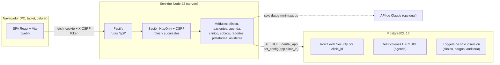
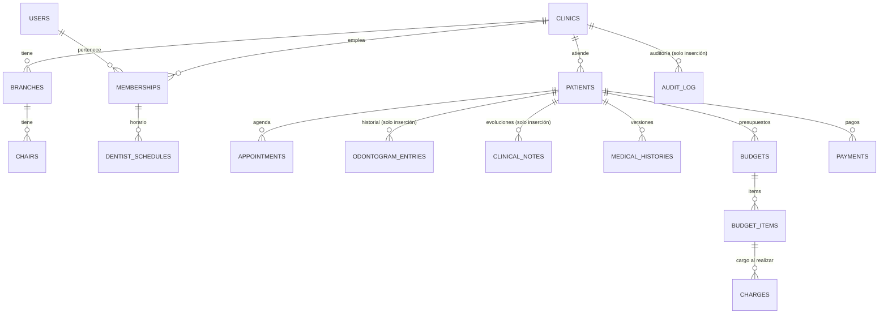

# Arquitectura — Plataforma odontológica (Dentalia)

> Estado: v0.1 (primera entrega). Este documento describe **lo implementado**. Lo planificado se marca como tal.

## 1. Vista general

- **Un solo servicio** sirve la API y el frontend compilado: un dominio, sin CORS. Se despliega con el `Dockerfile` en Railway o en cualquier host con Docker.
- **Documentación de la API:** OpenAPI 3.1 generada desde los esquemas de validación, en `/api/docs`.

## 2. Multiempresa y aislamiento (defensa en profundidad)

Cada clínica es una empresa independiente dentro del mismo esquema. El aislamiento tiene **cuatro capas**:

| Capa | Mecanismo | Qué evita |
|---|---|---|
| 1. Contexto de sesión | La clínica activa sale de la sesión del servidor, nunca de un parámetro del cliente | Que un usuario "elija" otra clínica |
| 2. Row Level Security | Todas las tablas operativas tienen la política `clinic_id = app_clinic_id()`. La app se conecta con el rol `dental_app` (sin BYPASSRLS y sin ser dueño), fijado como parámetro de arranque de cada conexión | Que un error de programación (una consulta sin `WHERE clinic_id`) filtre datos |
| 3. Claves foráneas compuestas | `(patient_id, clinic_id) → patients(id, clinic_id)` y equivalentes | Que una fila de la clínica A apunte a una fila de la clínica B. Los chequeos de FK ignoran RLS, por eso esta capa es necesaria |
| 4. Contexto transaccional | `withTenant()` abre una transacción y fija `app.clinic_id` y `app.user_id` con `set_config(..., true)` | Que una conexión reutilizada arrastre el contexto de otra petición |

- **Superadministrador SaaS:**
  - usa un pool aparte (rol dueño), solo en `/api/platform/*`;
  - devuelve **agregados** (conteos y actividad), nunca datos de pacientes;
  - no tiene clínica activa, así que la API clínica le responde "selecciona clínica".
- **Pruebas que lo verifican:** `tests/isolation.test.ts`, entre otras:
  - API cruzada → 404;
  - SQL directo con contexto de otra clínica → 0 filas;
  - INSERT con un `clinic_id` ajeno → rechazado por RLS.

## 3. Autenticación, roles y permisos

- **Contraseñas:**
  - scrypt (N=32768, r=8, p=1) con sal aleatoria;
  - política de 10 caracteres o más, combinando letras y números.
- **Sesiones:**
  - un token aleatorio de 256 bits viaja en una cookie `HttpOnly; SameSite=Lax` (y `Secure` en producción);
  - en la base solo se guarda su SHA-256;
  - duran 12 h por defecto;
  - se revocan al cerrar sesión, al cambiar la contraseña (cierra las demás) o al desactivar a la persona.
- **CSRF:** toda operación que modifica datos exige la cabecera `X-CSRF-Token`, que coincide con un token propio de la sesión.
- **Fuerza bruta:**
  - 5 intentos fallidos bloquean la cuenta 15 minutos;
  - límite de 10 intentos por minuto por IP en el login;
  - mensaje genérico, sin revelar si el correo existe;
  - tiempos igualados.
- **Roles** (`server/src/lib/rbac.ts`): propietario, administrador, recepción, odontólogo, asistente y contabilidad. Los permisos son explícitos, por ejemplo `clinical.read` o `payments.verify`. Algunas reglas:
  - el propietario y el administrador **solo acceden a lo clínico si además son profesionales** (minimización);
  - recepción no ve historia clínica ni alertas médicas;
  - contabilidad no modifica pacientes.
- **Alcance por sucursal:** la membresía tiene `all_branches` o una lista `branch_ids`. Toda escritura con sucursal llama a `requireBranch()`, y los listados se filtran por las sucursales permitidas.
- **Reglas finas:**
  - un odontólogo solo agenda en su propia agenda;
  - solo administración agenda fuera de horario;
  - solo el propietario asigna administradores y propietarios.
- **Verificación en dos pasos (v0.2):**
  - TOTP (RFC 6238) compatible con cualquier app autenticadora;
  - el secreto se cifra con AES-256-GCM y una clave de entorno propia (`DENTAL_MFA_KEY` desde v0.7, con rotación por `DENTAL_MFA_KEY_PREVIOUS`; los enlaces se firman con otra clave, `DENTAL_LINK_KEY`), así que un respaldo de la base por sí solo no permite generar códigos;
  - el rol de la aplicación no puede leer el hash de la contraseña ni estos secretos (privilegios por columna; el ingreso usa funciones mínimas de la base, v0.7);
  - el ingreso fallido responde siempre lo mismo y el bloqueo es por cuenta + origen, con límite global por cuenta y desbloqueo por correo (v0.7);
  - tras la contraseña, la sesión queda en `mfa_pending` (1 h, sin acceso a datos) hasta ingresar el código; 5 errores anulan la sesión;
  - 10 códigos de recuperación hasheados, de un solo uso;
  - la política por rol se guarda en `clinics.settings.mfaRequiredRoles`: el servidor bloquea toda la API, salvo la activación, hasta que la persona active los 2 pasos.
- **Sesiones restringidas:** el helper de rutas rechaza cualquier endpoint que no declare `restricted` mientras la sesión esté pendiente del segundo paso, con contraseña temporal o con activación obligatoria.
- **Recuperación de contraseña:**
  - token aleatorio de 256 bits (se guarda su SHA-256), 30 minutos y un solo uso;
  - respuesta idéntica exista o no el correo;
  - cierra todas las sesiones.
  - **Restablecimiento por administración:** solo si la persona pertenece a **una** clínica, verificado con la función `user_clinic_count`. Así una clínica no puede tomar la cuenta de alguien que también trabaja en otra.
- **Consentimientos:**
  - `consent_templates` versionadas (editar = nueva versión);
  - `signed_documents` de solo inserción con copia del texto, firmante, decisión, firma PNG y hash SHA-256 del conjunto, verificado al abrir el documento.

## 4. Modelo de datos (resumen)

- **Dinero:** centavos en `bigint`. La moneda va por clínica (BOB por defecto) y las cuotas se reparten sin perder centavos.
- **Tiempo:** `timestamptz` en UTC. Cada clínica tiene su zona horaria (`America/La_Paz`), que se usa para horarios, disponibilidad y reportes diarios.
- **Correlativos por clínica** (N° de ficha, presupuesto y recibo): tabla `counters` con `UPDATE … RETURNING` dentro de la transacción.
- **Saldo del paciente** = Σ cargos (los positivos de tratamientos realizados y los negativos de anulaciones) − Σ pagos **confirmados**. Los pagos pendientes de verificación se muestran aparte.

## 5. Integridad garantizada por la base de datos

| Riesgo | Garantía | Dónde |
|---|---|---|
| Doble reserva (dos recepciones a la vez) | `EXCLUDE USING gist` por profesional, por consultorio y por paciente sobre `tstzrange(starts_at, ends_at)`; las citas canceladas o inasistidas liberan el horario | `appointments` |
| Doble clic al agendar o cobrar | `idempotency_key` única por clínica; el cliente genera una clave por diálogo | `appointments`, `payments` |
| La misma transferencia registrada dos veces | Índice único `(clinic, method, bank_reference)` para pagos pendientes o confirmados | `payments` |
| Alterar un monto ya cobrado | GRANT solo sobre las columnas de estado + trigger que bloquea cambios de monto, paciente o fecha, y transiciones inválidas, **incluso para el dueño de la base** | `payments_guard` |
| Borrar historia clínica o auditoría | Sin privilegio DELETE/UPDATE + trigger `forbid_mutation` | `clinical_notes`, `odontogram_entries`, `medical_histories`, `charges`, `audit_log` |
| Cobrar dos veces un tratamiento | Bloqueo `FOR UPDATE` del ítem + transición `pending → done`; las anulaciones son asientos negativos | `budget_items`, `charges` |
| Pagar más que el presupuesto | Validación transaccional con bloqueo del presupuesto | `POST /api/payments` |

## 6. Módulos del servidor (`server/src/modules`)

| Módulo | Responsabilidad principal |
|---|---|
| `auth` | Login, logout, `/me`, cambio de clínica y de contraseña |
| `clinic` | Datos de la clínica, sucursales, consultorios, personal, horarios, bloqueos, catálogo de prestaciones, auditoría |
| `patients` | Búsqueda sin tildes, duplicados, ficha, antecedentes versionados, importación y exportación Excel (protegida contra inyección de fórmulas) |
| `agenda` | Citas, disponibilidad, búsqueda de huecos en varios días, estados, reprogramación, lista de espera, "recuperar huecos" y recordatorios con consentimiento |
| `clinical` | Odontograma FDI (permanente y temporal, 5 superficies, estados existente/planificado/realizado), anulaciones con historial y evoluciones con enmiendas |
| `billing` | Presupuestos con cuotas, tratamientos realizados (cargo + odontograma), pagos, verificación dual, anulaciones y caja diaria |
| `reports` | Panel por sucursal (cobrado, producción, ocupación, inasistencia, conversión), producción y comisión por profesional, cuentas por cobrar, exportaciones |
| `platform` | Superadministrador: planes, clínicas, estados y métricas agregadas |
| `assistant` | Herramientas con permisos, acciones rápidas y chat opcional con Claude |
| `consents` | Plantillas versionadas, documentos firmados con hash, consentimientos de recordatorios y marketing |
| `recalls`, `appointmentEvents`, `visitQuality` | Controles "volver a citar", eventos inmutables de la cita, informe de calidad de la atención |
| `cashSessions`, `fees` | Caja por cajero con arqueo y cierre inmutable; liquidación de honorarios |
| `perio` | Periodontograma (datos JSON validados por la API y por un CHECK en la base) e índices |
| `budgets-v2*` | Descuentos prorrateados, sesiones, versiones, enlace público al paciente, embudo, `patient_money` |
| `portal/*` | Reserva online y portal del paciente (API pública por slug, código de un solo uso, sesiones `psid`), bandeja de mensajes |
| `biosafety` | Limpieza por consultorio y libro de esterilización |
| `myday` | Agenda del día del profesional con alertas médicas |
| `inventory/*` | Catálogo, lotes, movimientos de solo inserción aplicados por trigger (invariante lotes = stock), transferencias, conteos, compras y consumo estándar por prestación |
| `lab`, `labPayables` | Órdenes de laboratorio con estados validados por trigger, eventos inmutables, cuentas por pagar y costo real para honorarios |
| `documents*`, `lib/pdf.ts` | Recetas, certificados, derivaciones y PDF (presupuesto, consentimiento, recibo) con huella SHA-256; el primer PDF se guarda y se sirve siempre igual. Textos de certificados por clínica en `certificate_template_versions` (solo inserción). Avisos de alergia (`lib/allergies.ts`) e interacciones orientativas (`lib/interactions.ts`, D-58) |
| `messaging/*` | Reglas, plantillas versionadas, programador idempotente, tokens de confirmación, adaptador de WhatsApp Cloud API y webhook |
| `onboarding/*` | Primeros pasos derivados de datos, importación por lotes (pacientes, citas, saldos iniciales) idempotente y saldos de apertura |
| `lib/filestore-s3.ts`, `lib/sigv4.ts`, `clinicalFilesSweep` | Controlador S3 compatible con firma SigV4 propia, miniaturas y barrido de huérfanos |
| `lib/xlsxSafe.ts`, `lib/logger.ts` | Toda exportación Excel protegida contra fórmulas; registros sin consultas, tokens ni detalles de la base |
| `clinicalFiles*`, `lib/filestore.ts` | Imágenes y archivos clínicos: interfaz `FileStore` (disco local; S3 previsto), verificación por firma de bytes, SHA-256, enlaces HMAC de 5 min atados a la persona, auditoría de cada entrega |
| `management/*` | Gastos, gastos fijos recurrentes, fichaje, rentabilidad por sucursal y sillón, comparación de períodos y exportaciones a Excel |
| `coordination/*` | Tareas internas, llamadas, diario de actividad sobre la auditoría (cursor) y tarjetas proactivas del Inicio |
| `experience/*` | Familias, etiquetas, segmentos y campañas, encuestas NPS (un detractor crea una tarea), llegada con QR |
| `agreements/*` | Convenios, afiliaciones, porción del tercero calculada por trigger, cuentas por cobrar por empresa, pendiente de facturar y conciliación bancaria |
| `appointmentTypes`, `agendaSeries`, `agendaViews`, `patientTimeline` | Tipos de cita, series recurrentes (`lib/recurrence.ts`), vista semanal e historial del paciente según permisos |

**Patrón de ruta** (`lib/http.ts`): cada endpoint declara acceso, permiso y esquemas zod (para validar y para OpenAPI). El helper aplica autenticación, CSRF y permisos y abre la transacción con contexto. Así ningún endpoint puede "olvidar" el aislamiento.

## 7. Asistente de IA

Principios aplicados en `server/src/modules/assistant.ts`:

1. **Solo datos reales.** El modelo no tiene acceso a la base: invoca herramientas del servidor (`ventas_por_sucursal`, `buscar_horarios_libres`, `presupuestos_pendientes`, `preparar_recordatorios`, `pacientes_sin_proxima_cita`, `resumen_agenda`, `proponer_cita`). Cada una verifica **el permiso del usuario** y corre en una transacción corta con RLS.
2. **Minimización.**
   - Al modelo le llegan agregados, nombres de pila o N° de ficha.
   - Los teléfonos, enlaces y listas completas van **directo a la interfaz**, nunca al proveedor de IA.
   - Ninguna herramienta lee notas clínicas.
3. **Sin acciones autónomas.** `proponer_cita` devuelve una **propuesta**. La persona la confirma en pantalla, y la interfaz llama al endpoint normal con todas sus validaciones (solapes, horario, permisos).
4. **Sin diagnóstico.** Lo prohíbe el *system prompt*. Las decisiones clínicas son del profesional.
5. **Funciona sin IA.** Sin `ANTHROPIC_API_KEY`, el chat responde 503 y las mismas herramientas operan como "acciones rápidas".
6. **Modelo:** `claude-opus-5-5` por defecto (configurable con `ASSISTANT_MODEL`), esfuerzo `low` y *fallback* del lado del servidor ante rechazos. Cada uso de herramienta queda en la auditoría.

## 8. Frontend (`web/`)

- React 19 + React Router y CSS propio con un sistema de diseño (`styles.css`): tokens, tablas, KPI, diálogos y agenda. No usa librería de componentes, para mantener el control visual y el peso bajo (~120 kB gzip).
- Fuente Inter servida localmente (sin llamadas a Google desde los consultorios). Íconos de `lucide-react`.
- **Responsive:**
  - barra lateral en escritorio y barra inferior en el celular;
  - la agenda pasa a vista de lista;
  - columnas secundarias ocultas.

  Una prueba e2e verifica que no haya desborde horizontal.
- **Accesibilidad:** etiquetas asociadas a los controles, roles ARIA en diálogos y pestañas, foco visible y navegación por teclado en la agenda y el odontograma.

## 9. Operación

| Tema | Implementación |
|---|---|
| Migraciones | SQL versionado (`server/migrations/NNNN_*.sql`) con checksum y bloqueo consultivo. Se aplican al arrancar (`MIGRATE_ON_START`, activo por defecto) o con `npm run migrate` |
| Copias de seguridad | `scripts/backup.sh`: `pg_dump` en formato custom, cifrado AES-256 opcional (`BACKUP_PASSPHRASE`) y SHA-256. `scripts/restore.sh` restaura **en una base vacía**. Las herramientas `pg_dump`/`pg_restore` deben ser de la misma versión mayor que el servidor de destino o más nuevas, y conviene restaurar en la misma versión mayor de PostgreSQL. La prueba `tests/backup.test.ts` comprueba que la restauración conserva los datos y que RLS sigue activo |
| Secretos | Solo variables de entorno (`.env.example`). Nada en el código ni en el repositorio |
| Seguridad HTTP | Helmet + CSP estricta (`script-src 'self'`, `frame-ancestors 'none'`), `Cache-Control: no-store` en la API y límite global de solicitudes |
| Respaldo programado y simulacro (v0.7) | `backup:run`: el volcado y los conteos salen de una misma instantánea; cifrado compatible con openssl; manifiesto; retención 7/4/12. `backup:verify`: simulacro en `dental_restore_*` con 9 verificaciones, incluida la firma HMAC del manifiesto (AES-CBC solo no detecta alteraciones). Los dos quedan registrados en `backup_runs` |
| Salud | `GET /api/health` (vida; lo usan el Dockerfile y Railway) y `GET /api/ready` (base, migraciones y almacenamiento; solo responde `{ok}`) |
| Monitoreo y alertas (v0.7) | Métricas en memoria por patrón de ruta (cantidad, 5xx, p50/p95, solicitudes lentas de más de 1 s sin datos personales) y panel «Estado del sistema» para la plataforma. Alertas por correo y webhook guardadas en `ops_alerts`, sin repetirse |
| Escalabilidad | Servidor sin estado (las sesiones viven en PostgreSQL), así que escala horizontalmente. Índices por `(clinic_id, …)` en todas las consultas calientes. Más adelante: réplicas de lectura para reportes y particionado de `audit_log` por fecha |

## 10. Archivos clínicos (planificado)

Radiografías, fotografías y consentimientos firmados irán en almacenamiento de objetos privado (S3 compatible), con:
- clave por clínica;
- URL firmadas de corta duración, emitidas **solo** tras validar el permiso;
- registro de cada descarga en la auditoría;
- cifrado en reposo del proveedor y hash SHA-256 por archivo.

## 11. Superficies públicas (sin sesión del personal)

| Ruta | Protección |
|---|---|
| `/restablecer` | Token de un solo uso (SHA-256 guardado), 30 min |
| `/p/presupuesto/:token` | Token por presupuesto, que vence y se puede revocar; verificación con los 4 últimos dígitos del celular o la fecha de nacimiento; bloqueo tras 5 intentos; nada visible antes de verificar |
| `/verificar/:código` | Solo responde si el documento existe, está íntegro y vigente; no muestra datos del paciente |
| `/e/:token` (encuesta), `/llegada/:token` (QR de llegada) | Tokens firmados por propósito; sin datos clínicos ni nombres; un solo uso o idempotentes; límite de intentos |
| `/c/:token` | Token de un solo uso por cita para confirmar o pedir reprogramar; vence con la cita |
| `/api/webhooks/whatsapp` | Firma HMAC de Meta (`WHATSAPP_APP_SECRET`); solo registra estados de entrega y respuestas «BAJA» |
| `/reservar/:slug`, `/mi-cuenta/:slug` | Solo si la clínica habilitó la reserva (función `portal_clinic_by_slug`); código de 6 dígitos (10 min, 5 intentos); sesión del paciente `psid` separada; límites por IP y documento; respuestas idénticas exista o no el paciente |

La parte del paciente se carga como un bloque aparte (`lazy`), con estilos propios pensados para el celular.

## 12. Saldo del paciente: una sola fórmula (v0.6)

`patient_money_v` (vista con `security_invoker`, respeta RLS de quien consulta) calcula para cada paciente: lo cargado a su cargo (cargos menos la porción de la empresa, más lo trasladado desde la empresa), los saldos iniciales importados y los pagos confirmados. `patient_money(p)` lee esa vista para un paciente y los informes la leen por lotes. Ningún módulo calcula el saldo por su cuenta; `tests/perf-rewrites.test.ts` compara la vista con una fórmula de referencia escrita aparte.

## 13. Guardas automáticas de seguridad (v0.6)

- `tests/route-guard.test.ts` recorre el OpenAPI: toda ruta del personal responde 401 sin sesión y 403 a un rol sin el permiso; las rutas públicas están en una lista explícita.
- `tests/db-hardening.test.ts`: toda tabla con `clinic_id` tiene RLS y la política `tenant_isolation`; las tablas de solo inserción no tienen UPDATE ni DELETE para `dental_app`; las funciones `SECURITY DEFINER` están revisadas. Una tabla nueva que no cumpla hace fallar la prueba.
