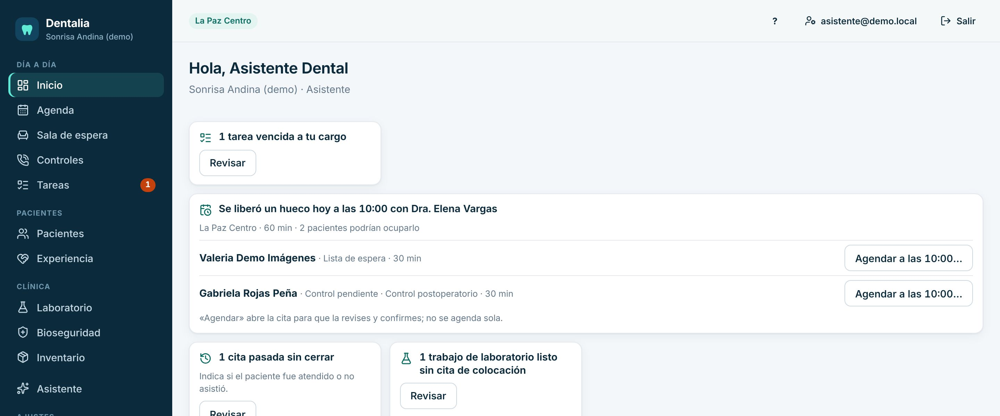
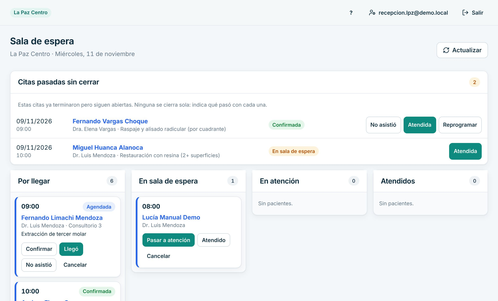
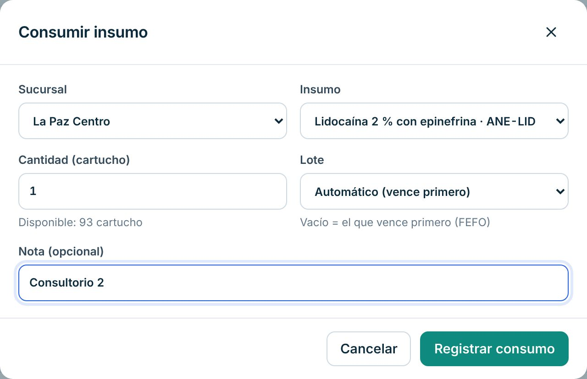
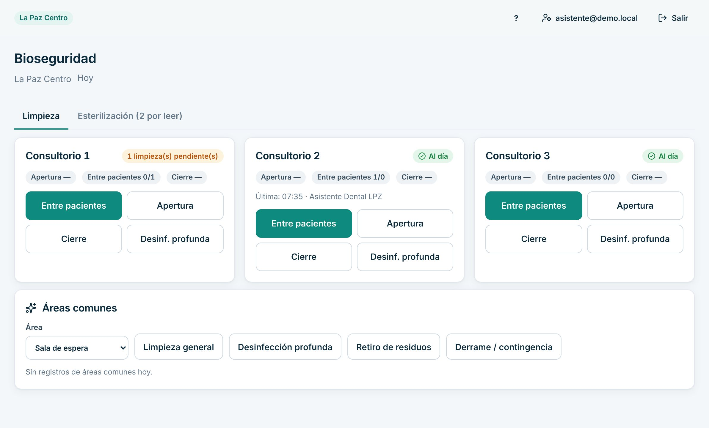
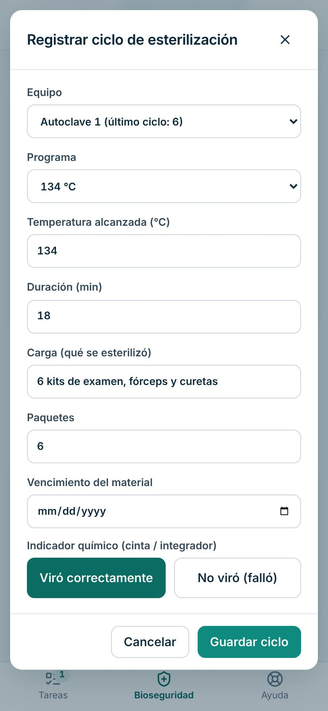

# Manual de Asistente dental

Para asistentes que ayudan en el consultorio: sala de espera, agenda, materiales, limpieza y esterilización.

> Cada paso de este manual se probó en la clínica de demostración, con datos inventados. Lo marcado como «[La clínica completa: …]» lo define tu clínica.

## Cómo entrar

1. Abre Dentalia en el navegador: [La clínica completa: dirección web de Dentalia].
2. Escribe tu **Correo** y tu **Contraseña** y pulsa «Ingresar».
3. La primera vez el sistema te pide cambiar la contraseña temporal.
4. Si olvidaste la contraseña, pulsa «Olvidé mi contraseña».

## Qué ves al entrar

- **Avisos para hoy**, entre ellos tus tareas vencidas.
- **Tus tareas**: lo que te pidió el equipo.
- **Mi asistencia**: marcar entrada y salida (si gerencia lo activó para ti).
- **Citas de hoy** de tu sucursal.
- En el menú, entre otras: Agenda, Sala de espera, Controles, Tareas, Pacientes, Laboratorio, Bioseguridad e Inventario.

## Tu día a día

### 1. Marcar tu entrada y salida

1. En el Inicio, tarjeta «Mi asistencia», pulsa «Marcar entrada» al llegar.
2. Al irte, «Marcar salida».

Se guarda la hora del sistema, sin tu ubicación.

### 2. Atender tus tareas

1. En el Inicio o en «Tareas», revisa tus pendientes. Las vencidas se marcan como «Vencida».
2. Pulsa «Tomar» si vas a hacerla tú.
3. Al terminar, «Marcar hecha».

### 3. Recibir al paciente y pasarlo al consultorio

Funciona igual que en recepción:

1. Abre «Sala de espera».
2. «Llegó» cuando el paciente se presenta.
3. «Pasar a atención» cuando entra al consultorio.
4. «Atendido» al terminar.

### 4. Agendar o mover una cita

Puedes usar la Agenda igual que recepción: «Buscar horario», «Nueva cita», y en cada cita «Confirmar», «Reprogramar» o «Cancelar cita». Los pasos están en el [manual de Recepción](recepcion.md).

### 5. Consultar la ficha clínica

1. Abre «Pacientes» y la ficha del paciente.
2. Puedes leer «Historia clínica», «Odontograma» y los antecedentes médicos.

Tú no firmas evoluciones: eso lo hace el odontólogo.

### 6. Registrar los materiales usados

1. Abre «Inventario» (con la sucursal correcta).
2. Pulsa «Consumir».
3. Elige el «Insumo» y escribe la «Cantidad». El «Lote» vacío usa el que vence primero.
4. Si quieres, escribe una «Nota (opcional)», por ejemplo el consultorio.
5. Pulsa «Registrar consumo».

Los tratamientos con consumo estándar descuentan materiales solos cuando el odontólogo los marca realizados.

### 7. Registrar la limpieza del consultorio

1. Abre «Bioseguridad», pestaña «Limpieza».
2. En el consultorio que limpiaste, pulsa la tarea: «Apertura», «Entre pacientes», «Cierre» o «Desinf. profunda».
3. Para baños, pasillos o sala de espera, usa «Áreas comunes»: elige el «Área» y la tarea.

Queda la hora y quién lo hizo. Protocolo de limpieza de la clínica: [La clínica completa: productos y frecuencia].

### 8. Registrar un ciclo de esterilización

1. En «Bioseguridad», abre la pestaña «Esterilización».
2. Pulsa «Registrar ciclo».
3. Revisa «Equipo» y «Programa». Completa «Carga (qué se esterilizó)» y «Paquetes».
4. En «Indicador químico», marca «Viró correctamente» o «No viró (falló)».
5. Pulsa «Guardar ciclo».
6. Cuando tengas el resultado del indicador biológico, pulsa «Registrar» en ese ciclo y elige «Negativo (sin crecimiento)» o «Positivo (crecimiento)». Pulsa «Guardar».

Si un indicador falla, el sistema lo muestra arriba de la pantalla en rojo. Avisa a gerencia y no uses esa carga.

## Si algo sale mal

- **Registré un consumo equivocado.** Los consumos no se borran. En «Inventario» pulsa «Ajustar», elige «Sumar (+)», escribe la cantidad y el motivo y pulsa «Registrar ajuste».
- **Marqué la limpieza equivocada.** Avisa a gerencia. [La clínica completa: cómo se corrige]
- **Un indicador biológico salió positivo.** No uses esa carga. Avisa de inmediato a gerencia y al odontólogo. [La clínica completa: protocolo]
- **El paciente no aparece.** Búscalo por CI, celular o N° de ficha en «Pacientes».
- **Se cortó internet.** Arriba aparece «Sin conexión a internet…». Anota en papel y registra al volver la conexión.

## Lo que no puedes hacer en el sistema

| Necesitas | Pídeselo a |
|---|---|
| Firmar evoluciones, emitir recetas o hacer presupuestos | El odontólogo |
| Cobrar o ver la caja | Recepción o caja |
| Corregir una marca de entrada o salida | Gerencia |
| Crear o editar insumos del catálogo | Gerencia o la dueña |

Para imprimir lo esencial, usa la [hoja de una página](chuleta-asistente.md).
