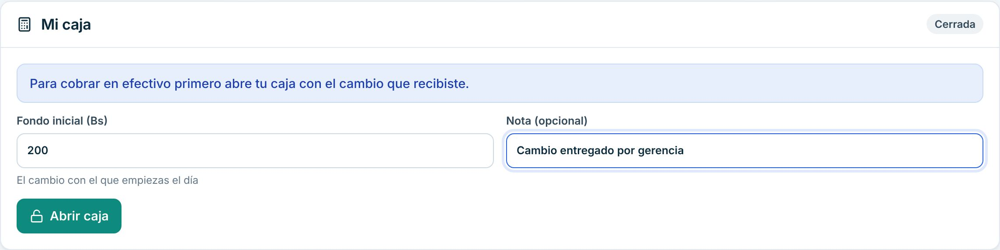
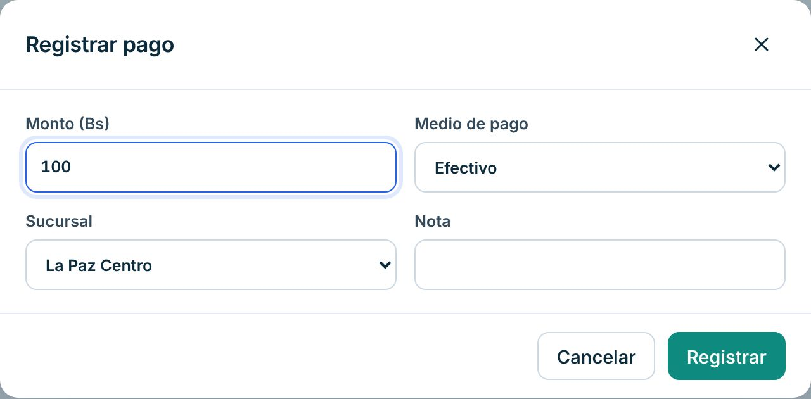
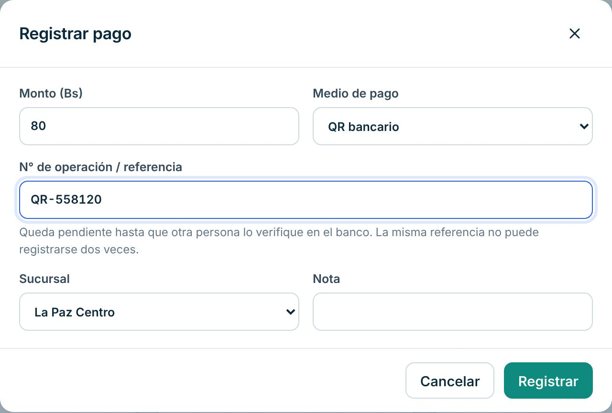
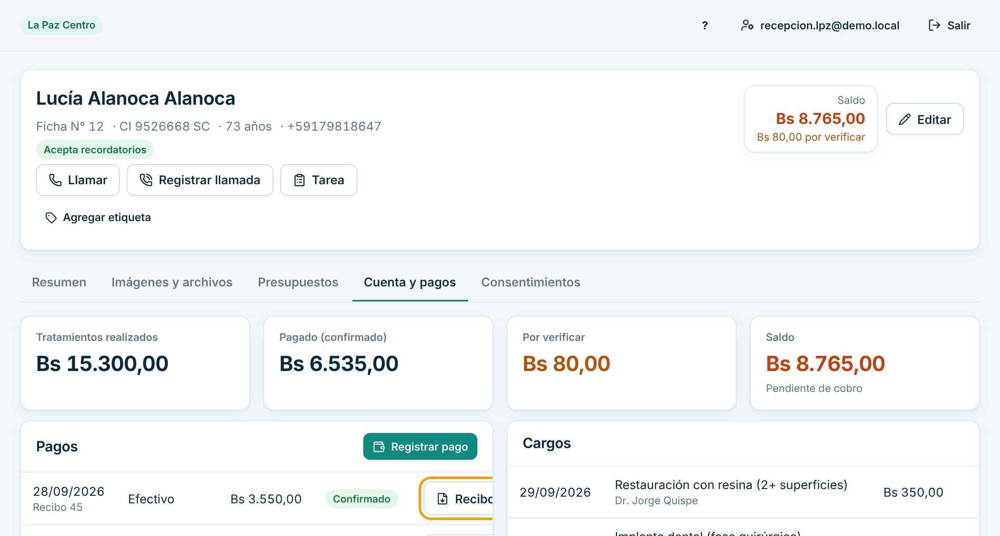
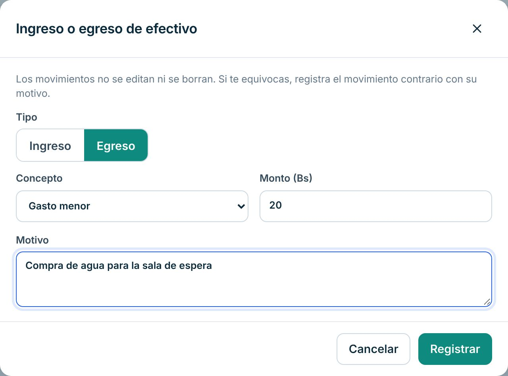
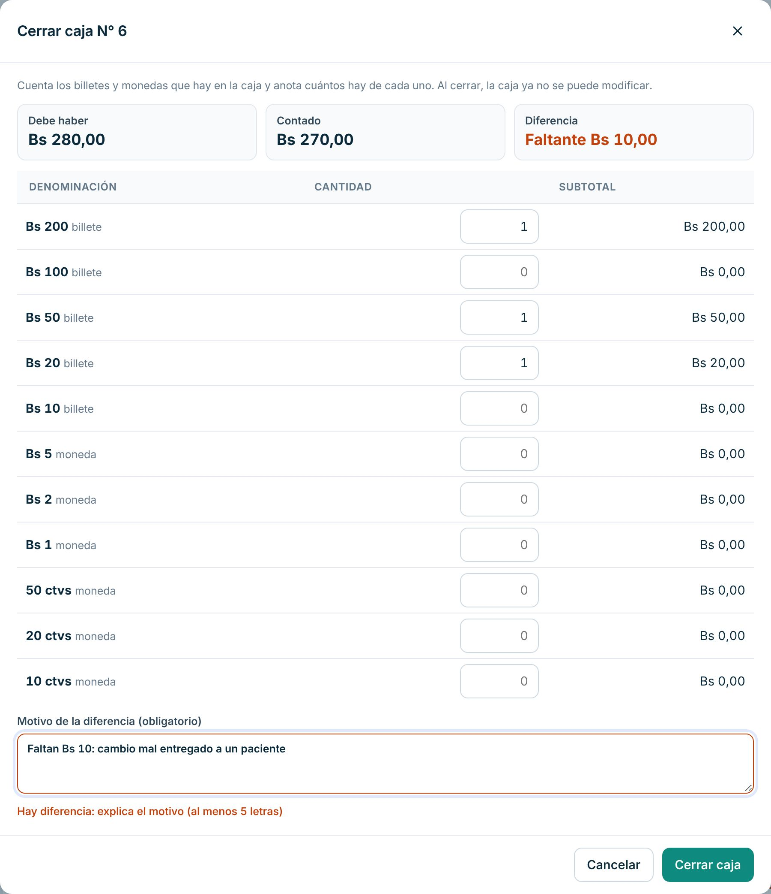
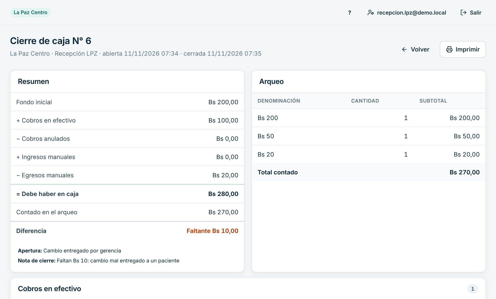
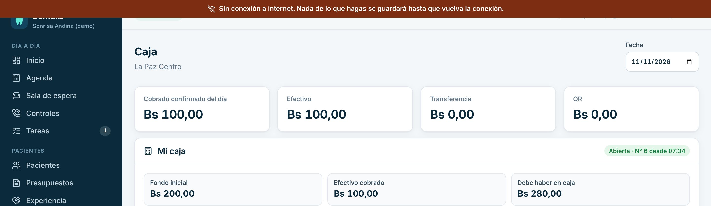

# Manual de Caja

Para quien cobra a los pacientes y cuida el efectivo de su turno. En el sistema entras con el rol **Recepción**: la caja es una parte de ese puesto. Para agendar y recibir pacientes, mira el [manual de Recepción](recepcion.md).

> Cada paso de este manual se probó en la clínica de demostración, con datos inventados. Lo marcado como «[La clínica completa: …]» lo define tu clínica.

## Reglas de oro

- **Efectivo:** queda confirmado al registrarlo.
- **QR, transferencia o tarjeta:** quedan «Por verificar» hasta que **otra persona** lo vea en el banco. Una captura de pantalla no prueba que el dinero llegó.
- **Nada se borra.** Si te equivocas, se anula con un motivo y queda registrado quién lo hizo.
- **El recibo no es una factura.** [La clínica completa: cómo se emite la factura y quién la emite]

## Qué ves al entrar

Entras igual que recepción (ver «Cómo entrar» en el [manual de Recepción](recepcion.md)). Para cobrar, abre «Caja» en el menú.

En «Caja» ves:
- arriba, lo cobrado y confirmado del día, en total y por medio de pago, con un selector de «Fecha»;
- «Mi caja»: abrir, mover y cerrar tu caja;
- «Movimientos del día»: cada cobro con su recibo;
- «Mis cierres de caja»: tus cierres anteriores y si gerencia ya los revisó.

## Tu día a día

### 1. Abrir tu caja

1. Abre «Caja».
2. En «Mi caja», escribe el «Fondo inicial (Bs)»: el cambio con el que empiezas.
3. Si quieres, agrega una «Nota (opcional)», por ejemplo quién te dio el cambio.
4. Pulsa «Abrir caja».

Si tu clínica exige caja abierta (lo decide gerencia), no podrás cobrar en efectivo sin abrirla: el sistema dice «Abre tu caja en esta sucursal antes de registrar cobros en efectivo». Fondo inicial habitual: [La clínica completa: monto].

### 2. Cobrar en efectivo

1. Abre «Pacientes», busca al paciente y abre su ficha.
2. Entra a la pestaña «Cuenta y pagos». Arriba ves el «Saldo».
3. Pulsa «Registrar pago».
4. Escribe el «Monto (Bs)» y deja «Medio de pago» en «Efectivo».
5. Revisa la «Sucursal» y pulsa «Registrar».

Aparece «Pago registrado · recibo N». Cuenta el dinero delante del paciente y entrégale su cambio.

### 3. Cobrar con QR, transferencia o tarjeta

1. Igual que en efectivo, pulsa «Registrar pago».
2. En «Medio de pago» elige «QR bancario», «Transferencia» o «Tarjeta».
3. Copia del comprobante el «N° de operación / referencia».
4. Pulsa «Registrar».

El pago queda «Por verificar». La misma referencia no se puede registrar dos veces.

### 4. Entregar el recibo

1. En la ficha, pestaña «Cuenta y pagos», busca el pago en la lista «Pagos».
2. Pulsa «Recibo»: se descarga en PDF para imprimir o enviar.

El recibo aparece cuando el pago está confirmado. Un pago «Por verificar» todavía no tiene recibo.

### 5. Sacar o poner efectivo (ingreso o egreso)

Por ejemplo: compraste agua para la sala, o gerencia te dio más cambio.

1. En «Caja», pulsa «Ingreso o egreso».
2. Elige «Ingreso» o «Egreso».
3. Elige el «Concepto» (por ejemplo «Gasto menor» o «Cambio / sencillo»).
4. Escribe el «Monto (Bs)» y el «Motivo».
5. Pulsa «Registrar».

Los movimientos no se editan ni se borran. Si te equivocas, registra el movimiento contrario con su motivo.

### 6. Cerrar tu caja (arqueo)

1. Al final del turno, en «Caja» pulsa «Cerrar caja (arqueo)».
2. Cuenta los billetes y monedas. Escribe **cuántos** hay de cada valor (no el monto).
3. Arriba ves «Debe haber», «Contado» y «Diferencia».
4. Si hay diferencia, escribe el motivo en «Motivo de la diferencia (obligatorio)».
5. Pulsa «Cerrar caja».

Al cerrar, la caja ya no se puede modificar. Se abre el reporte del cierre: pulsa «Imprimir» si tu clínica lo pide en papel.

Qué hacer con el efectivo al cerrar: [La clínica completa: dónde se guarda o a quién se entrega].

### 7. Revisar tus cierres anteriores

En «Caja», abajo, «Mis cierres de caja» muestra cada cierre con lo esperado, lo contado y la diferencia. La columna «Revisión» dice si gerencia o contabilidad ya lo revisó.

## Si algo sale mal

- **Cobré de más.** No registres otro pago ni un egreso. Pide a gerencia que **anule** ese pago con el motivo. Luego registra el pago con el monto correcto y devuelve la diferencia al paciente. La anulación ya descuenta ese pago de tu caja.
- **Elegí mal el medio de pago o el paciente.** Mismo caso: gerencia anula el pago y tú lo registras de nuevo bien.
- **Registré un QR con un monto equivocado.** Avisa a contabilidad: al verificar, lo rechaza con el motivo. Después lo registras bien.
- **No me deja cobrar en efectivo.** Si dice «Abre tu caja en esta sucursal…», abre tu caja primero («Abrir caja») y vuelve a registrar el pago.
- **La caja no cuadra.** Vuelve a contar. Si sigue la diferencia, ciérrala igual y explica el motivo. No pongas ni saques dinero para «cuadrar».
- **Se cortó internet.** Arriba aparece el aviso «Sin conexión a internet. Nada de lo que hagas se guardará hasta que vuelva la conexión.» Da un comprobante provisorio en papel [La clínica completa: talonario o planilla de respaldo] y registra el pago cuando vuelva la conexión.

- **El paciente no aparece.** Búscalo por CI, celular o N° de ficha. Si es nuevo, regístralo (ver el [manual de Recepción](recepcion.md)).

## Lo que no puedes hacer en el sistema

| Necesitas | Pídeselo a |
|---|---|
| Anular un pago confirmado o un cargo | Gerencia |
| Confirmar o rechazar un pago QR, transferencia o tarjeta | Contabilidad o gerencia (no puede hacerlo quien lo registró) |
| Revisar y dar por bueno tu cierre de caja | Gerencia o contabilidad |
| Hacer descuentos | [La clínica completa: quién autoriza descuentos] |
| Cambiar precios | Gerencia o la dueña |

Para imprimir lo esencial, usa la [hoja de una página](chuleta-caja.md).
