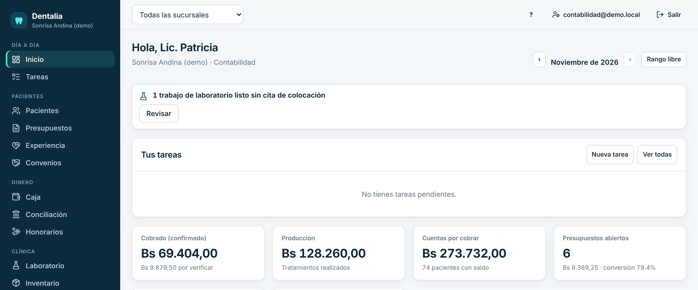
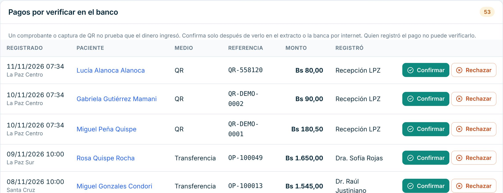
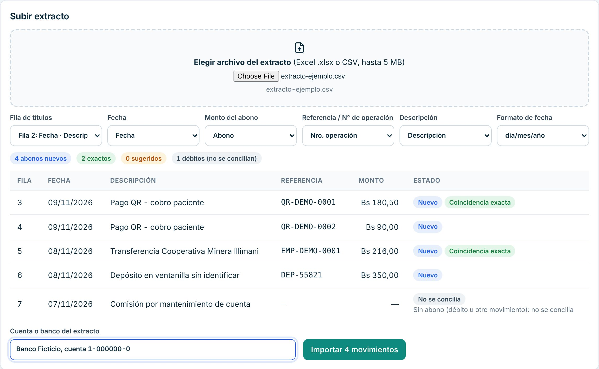
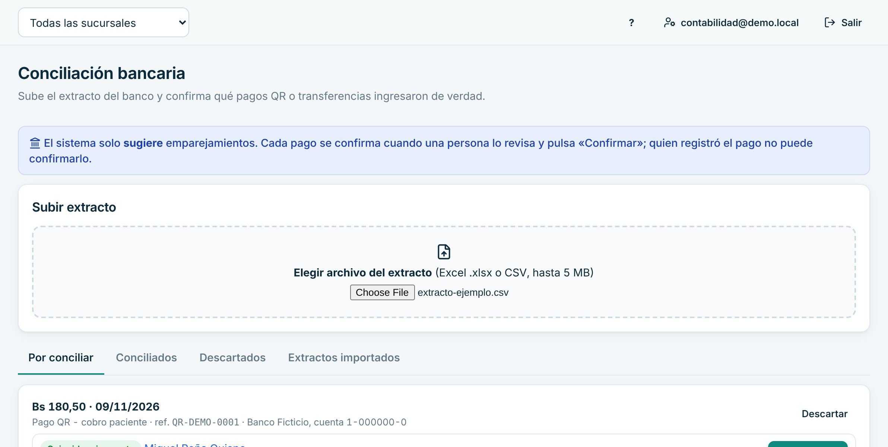
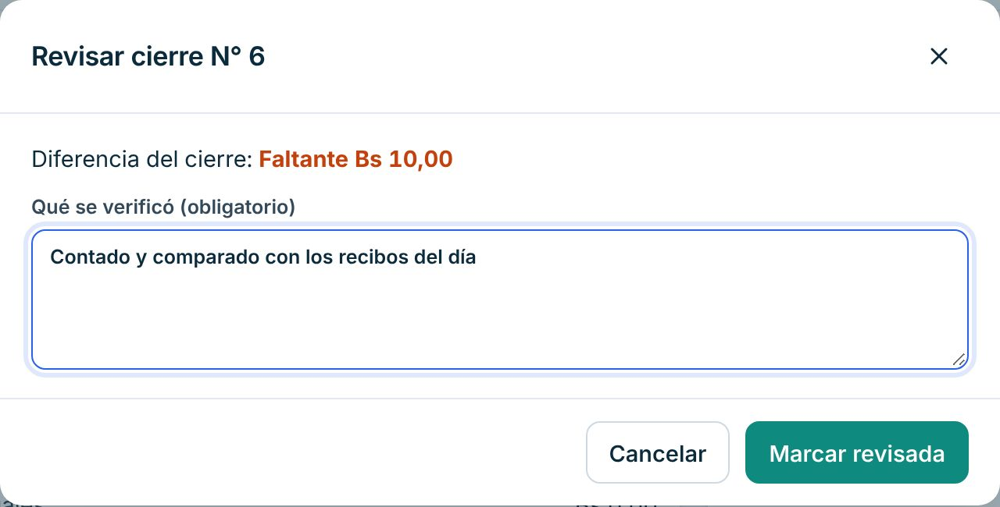
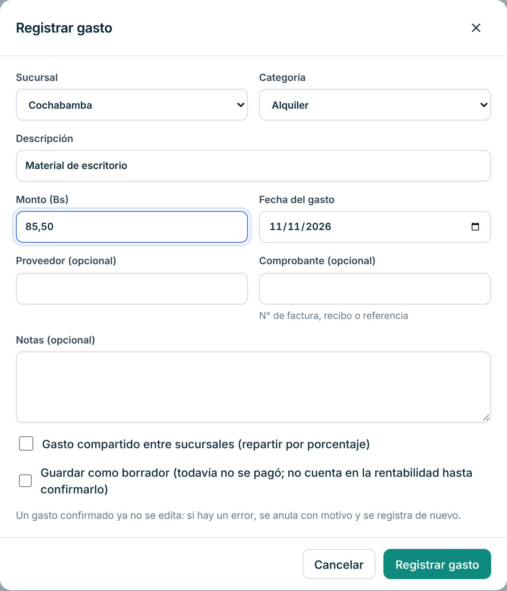
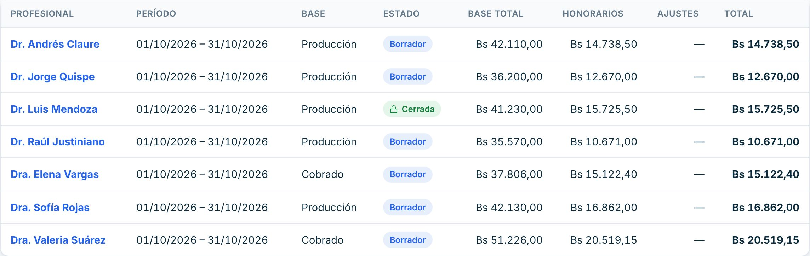
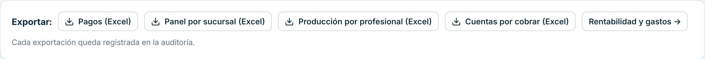

# Manual de Contabilidad

Para quien verifica el dinero que entra, concilia el banco, registra gastos y prepara honorarios e informes.

> Cada paso de este manual se probó en la clínica de demostración, con datos inventados. Lo marcado como «[La clínica completa: …]» lo define tu clínica.

## Cómo entrar

1. Abre Dentalia en el navegador: [La clínica completa: dirección web de Dentalia].
2. Escribe tu **Correo** y tu **Contraseña** y pulsa «Ingresar».
3. Si tu clínica exige verificación en dos pasos, el sistema te pide además el código de la app del celular. Se activa en «Mi cuenta» con «Activar».

Ves todas las sucursales. Arriba puedes elegir una sucursal o «Todas las sucursales».

## Qué ves al entrar

El Inicio muestra el mes: «Cobrado (confirmado)», lo que está por verificar, «Producción», «Cuentas por cobrar», presupuestos abiertos y citas, con la comparación por sucursal frente al período anterior. Con «‹» y «›» cambias de mes; «Rango libre» compara otras fechas.

## Tu día a día

### 1. Verificar pagos con QR, transferencia o tarjeta

1. Abre «Caja». La tarjeta «Pagos por verificar en el banco» lista lo pendiente.
2. Busca la referencia en el extracto o en la banca por internet.
3. Si el dinero llegó, pulsa «Confirmar».
4. Si no llegó, pulsa «Rechazar», escribe el «Motivo del rechazo» y pulsa «Rechazar».

Confirma solo lo que viste en el banco. Quien registró un pago no puede verificarlo: el botón aparece desactivado.

### 2. Conciliar con el extracto del banco

1. Abre «Conciliación».
2. En «Subir extracto», elige el archivo del banco (Excel .xlsx o CSV, hasta 5 MB).
3. Revisa que las columnas estén bien elegidas: «Fecha», «Monto del abono», «Referencia / N° de operación».
4. Escribe la «Cuenta o banco del extracto».
5. Pulsa «Importar N movimientos».

6. En la pestaña «Por conciliar», revisa cada movimiento. Si la sugerencia es correcta, pulsa «Confirmar» (o «Vincular» si el pago ya estaba verificado). Si no corresponde a ningún pago, «Descartar».

El sistema solo sugiere. Cada pago se confirma cuando una persona lo revisa. Volver a subir el mismo extracto no duplica movimientos.

### 3. Revisar los cierres de caja

1. En «Caja», abajo, «Cierres de caja» lista los cierres de todas las sucursales.
2. Pulsa el N° de un cierre con «Pendiente» en «Revisión».
3. Revisa el arqueo y los cobros. Pulsa «Marcar revisada».
4. Si hubo diferencia, escribe qué verificaste (es obligatorio). Pulsa «Marcar revisada».

### 4. Registrar un gasto

1. Abre «Gestión», pestaña «Gastos».
2. Pulsa «Registrar gasto».
3. Elige «Sucursal» y «Categoría». Escribe «Descripción», «Monto (Bs)» y «Fecha del gasto». Si tienes, el comprobante.
4. Pulsa «Registrar gasto».

Los gastos fijos mensuales se cargan con «Nuevo gasto fijo» y luego se confirman cada mes.

### 5. Preparar las liquidaciones de honorarios

1. Abre «Honorarios», pestaña «Liquidaciones».
2. Elige «Desde» y «Hasta» y pulsa «Preparar borradores del período».
3. Pulsa el nombre de cada profesional para revisar su borrador línea por línea. Puedes bajarlo en «Excel» o «Imprimir».

Mientras es borrador, los montos se recalculan. **Cerrar** la liquidación lo hace gerencia o la dueña.

### 6. Sacar reportes en Excel

1. Abre «Reportes» y elige «Desde» y «Hasta».
2. Descarga lo que necesites: «Pagos (Excel)», «Panel por sucursal (Excel)», «Producción por profesional (Excel)», «Cuentas por cobrar (Excel)» y otros.

Cada exportación queda registrada. Las cuentas por cobrar incluyen los saldos iniciales importados del sistema anterior.

### 7. Revisar convenios con empresas

En «Convenios» ves las empresas con convenio y su estado de cuenta. [La clínica completa: con qué empresas hay convenio y cada cuánto se les cobra]

## Si algo sale mal

- **Confirmé un pago que no llegó.** Avisa a gerencia: puede anular el pago con el motivo.
- **Rechacé un pago por error.** Pide a caja que lo registre de nuevo y verifícalo.
- **El extracto no se lee bien.** Revisa la «Fila de títulos» y las columnas elegidas, y el «Formato de fecha».
- **Un cierre de caja tiene diferencia.** Revisa los cobros y movimientos del reporte. Habla con la persona de caja antes de marcarlo revisado.
- **Se cortó internet.** No se guarda nada hasta que vuelva la conexión. Vuelve a intentar después.

## Lo que no puedes hacer en el sistema

| Necesitas | Pídeselo a |
|---|---|
| Verificar un pago que registraste tú | Otra persona con permiso (gerencia) |
| Anular un pago o un cargo | Gerencia |
| Cerrar una liquidación de honorarios | Gerencia o la dueña |
| Cobrar a un paciente | Caja o recepción |
| Cambiar precios, personal o configuración | Gerencia o la dueña |
| Facturar | [La clínica completa: sistema de facturación y responsable] |

Para imprimir lo esencial, usa la [hoja de una página](chuleta-contabilidad.md).
