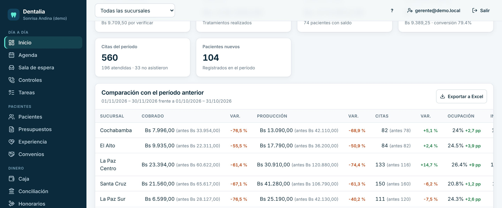
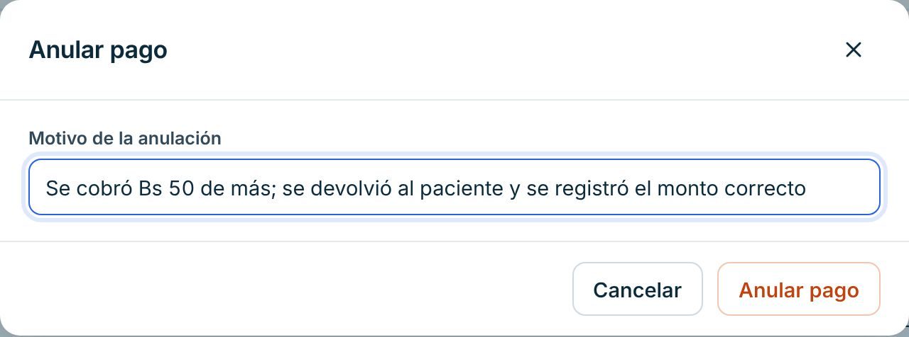
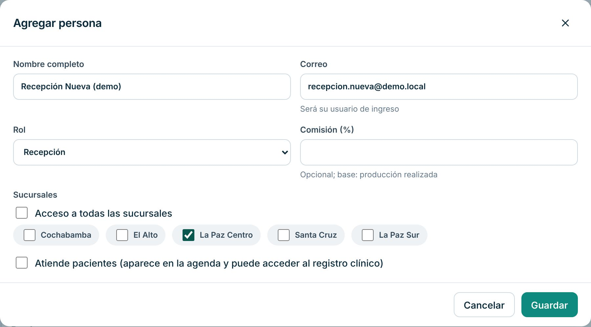
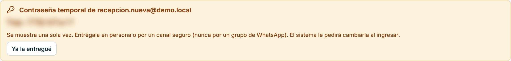
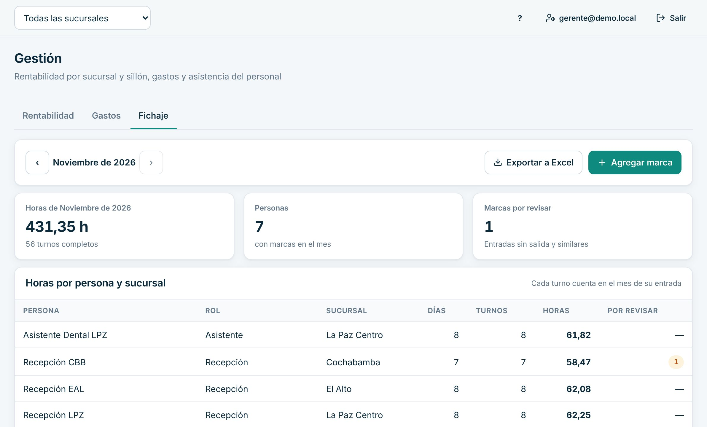
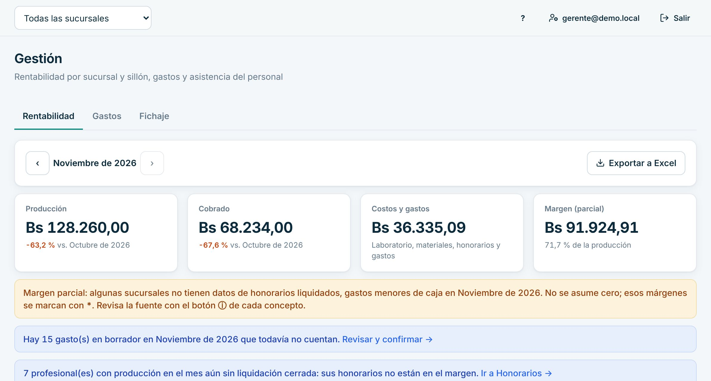
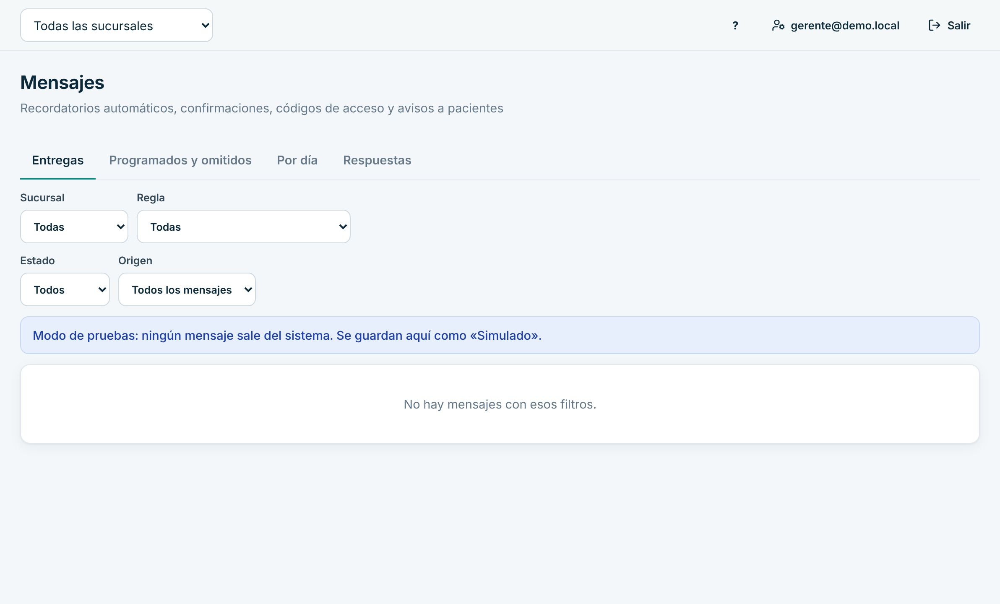

# Manual de Gerencia

Para la gerencia o administración de la clínica. En el sistema tu rol es **Administrador**: ves todas las sucursales, corriges errores de cobro, manejas el equipo y sigues los números.

> Cada paso de este manual se probó en la clínica de demostración, con datos inventados. Lo marcado como «[La clínica completa: …]» lo define tu clínica.

## Cómo entrar

1. Abre Dentalia en el navegador: [La clínica completa: dirección web de Dentalia].
2. Escribe tu **Correo** y tu **Contraseña** y pulsa «Ingresar».
3. Si la clínica exige verificación en dos pasos, escribe también el código de la app del celular. Se activa en «Mi cuenta» con «Activar».

## Qué ves al entrar

- Arriba, el selector de sucursal: una o «Todas las sucursales».
- **Primeros pasos**, mientras la clínica no termine de ponerse en marcha (ver el [manual de la dueña](propietaria.md)).
- **Avisos para hoy** y **Tus tareas**.
- Los números del mes: cobrado, por verificar, producción, cuentas por cobrar, presupuestos y citas.
- **Comparación con el período anterior** por sucursal, con «Exportar a Excel». «Rango libre» compara otras fechas.

## Tu día a día

### 1. Corregir un cobro: anular un pago

Cuando caja cobró de más, eligió mal el paciente o el medio de pago.

1. Abre «Caja» y elige la «Fecha» del cobro.
2. En «Movimientos del día», busca el pago y pulsa «Anular».
3. Escribe el «Motivo de la anulación» y pulsa «Anular pago».

El pago queda «Anulado»: no se borra. Si era efectivo, se descuenta de la caja de quien lo cobró. Después, caja registra el pago correcto. Solo se anulan pagos confirmados; un pago «Por verificar» se rechaza al verificarlo.

Para anular un **cargo** (un tratamiento cobrado por error), abre la ficha del paciente, pestaña «Cuenta y pagos», y pulsa «Anular» en ese cargo, con el motivo.

### 2. Verificar pagos y revisar cierres de caja

- En «Caja», la tarjeta «Pagos por verificar en el banco» funciona igual que para contabilidad: «Confirmar» o «Rechazar». No puedes verificar un pago que registraste tú.
- En «Cierres de caja», pulsa el N° de un cierre «Pendiente» y luego «Marcar revisada».

Los pasos con imágenes están en el [manual de Contabilidad](contabilidad.md).

### 3. Cerrar una liquidación de honorarios

1. Abre «Honorarios», pestaña «Liquidaciones», y pulsa «Preparar borradores del período».
2. Pulsa el nombre del profesional para abrir su borrador y revísalo.
3. Pulsa «Cerrar liquidación». Si quieres, escribe una «Nota (opcional)».
4. Pulsa «Cerrar por Bs …».

Al cerrarla se guarda una copia fija: ya no cambia. Las anulaciones posteriores se ajustan en la siguiente liquidación.

### 4. Agregar a una persona del equipo

1. Abre «Configuración», pestaña «Personal», y pulsa «Agregar persona».
2. Escribe «Nombre completo» y «Correo». Elige el «Rol».
3. En «Sucursales» marca dónde trabaja, o «Acceso a todas las sucursales».
4. Para odontólogos, marca «Atiende pacientes».
5. Pulsa «Guardar».

6. Aparece una **contraseña temporal** que se muestra una sola vez. Entrégala en persona o por un canal seguro (nunca en un grupo de WhatsApp). Pulsa «Ya la entregué».

La persona entra con esa contraseña y el sistema le pide cambiarla. Si alguien olvida su contraseña, en la misma lista pulsa «Restablecer contraseña».

### 5. Cargar el horario de un profesional

1. En «Configuración», pestaña «Horarios», elige el «Profesional».
2. Pulsa «Agregar turno» y completa «Día», «Sucursal», «Desde» y «Hasta».
3. Pulsa «Guardar horario».

La agenda no deja agendar fuera de ese horario.

### 6. Revisar la asistencia del personal

1. Abre «Gestión», pestaña «Fichaje».
2. Ves las horas por persona y sucursal del mes, y las «Marcas por revisar».
3. Si alguien olvidó marcar, pulsa «Agregar marca», completa los datos y el «Motivo», y pulsa «Guardar corrección».
4. «Exportar a Excel» descarga el informe del mes.

Las marcas no se editan: las correcciones quedan como marcas nuevas con su motivo.

### 7. Ver la rentabilidad

1. Abre «Gestión», pestaña «Rentabilidad».
2. Ves producción, cobrado, costos y gastos y el margen por sucursal y sillón.

Si faltan datos (por ejemplo honorarios sin liquidar o gastos en borrador), el sistema lo avisa en lugar de suponer cero.

### 8. Mensajes a pacientes

1. Abre «Mensajes» para ver las entregas, lo programado y las respuestas.
2. Fuera de producción, ningún mensaje sale: se guardan como «Simulado».

Las reglas de mensajes automáticos están en «Configuración» › «Mensajes automáticos».

### 9. Ver quién hizo qué

Abre «Actividad»: el diario muestra las acciones del equipo en frases claras, con filtros y exportación a Excel.

## Si algo sale mal

- **Anulé el pago equivocado.** No se puede «desanular». Pide a caja que registre de nuevo ese pago y anota lo ocurrido en el motivo.
- **Una persona no puede entrar.** Revisa en «Personal» que esté activa. Usa «Restablecer contraseña».
- **Una caja no cuadra.** Abre el reporte del cierre, revisa cobros, anulados y movimientos. Al marcarlo revisado, escribe qué verificaste.
- **Un indicador de esterilización falló.** Aparece en rojo en «Bioseguridad». [La clínica completa: protocolo ante un indicador positivo]
- **Se cortó internet.** No se guarda nada hasta que vuelva. [La clínica completa: plan de contingencia]

## Lo que no puedes hacer en el sistema

| Necesitas | Pídeselo a |
|---|---|
| Exigir verificación en dos pasos por rol (pestaña «Seguridad») | La dueña |
| Verificar un pago que registraste tú | Otra persona con permiso |
| Firmar evoluciones o emitir recetas (salvo que también atiendas) | El odontólogo |
| Cambios del plan o la suscripción de Dentalia | [La clínica completa: contacto con Dentalia] |

Para imprimir lo esencial, usa la [hoja de una página](chuleta-gerencia.md).
