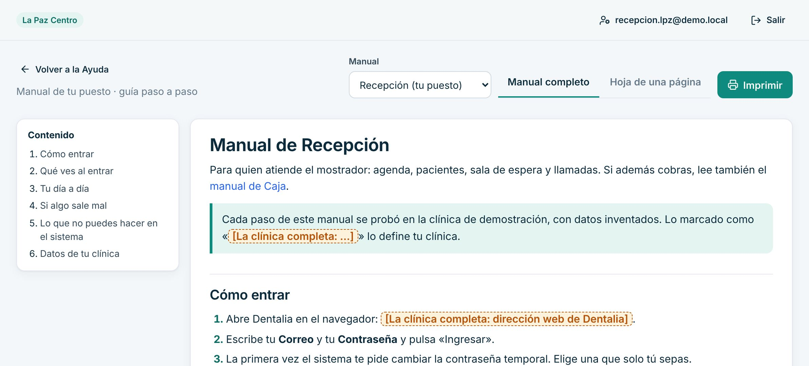

# Manuales por puesto

Manuales cortos para capacitar al personal de la clínica piloto y a los pacientes. También se leen dentro de Dentalia: **Ayuda › «Manual de mi puesto»** abre el del rol de quien entró, con la «Hoja de una página» y el botón «Imprimir».

| Puesto | Manual | Hoja de una página | Rol en el sistema |
|---|---|---|---|
| Recepción | [recepcion.md](recepcion.md) | [chuleta-recepcion.md](chuleta-recepcion.md) | Recepción |
| Caja | [caja.md](caja.md) | [chuleta-caja.md](chuleta-caja.md) | Recepción |
| Odontólogo | [odontologo.md](odontologo.md) | [chuleta-odontologo.md](chuleta-odontologo.md) | Odontólogo |
| Asistente dental | [asistente.md](asistente.md) | [chuleta-asistente.md](chuleta-asistente.md) | Asistente |
| Limpieza y apoyo | [limpieza.md](limpieza.md) | [chuleta-limpieza.md](chuleta-limpieza.md) | Limpieza y apoyo |
| Contabilidad | [contabilidad.md](contabilidad.md) | [chuleta-contabilidad.md](chuleta-contabilidad.md) | Contabilidad |
| Gerencia | [gerencia.md](gerencia.md) | [chuleta-gerencia.md](chuleta-gerencia.md) | Administrador |
| Dueña o dueño | [propietaria.md](propietaria.md) | [chuleta-propietaria.md](chuleta-propietaria.md) | Propietario |
| Pacientes y familias | [portal-paciente.md](portal-paciente.md) | [chuleta-portal-paciente.md](chuleta-portal-paciente.md) | Portal del paciente |

## Para quien mantiene estos manuales

- Cada paso está comprobado por `scripts/manual-shots.cjs`, que recorre los pasos con los usuarios demo en un navegador real y genera las capturas de `capturas/` (1440 px y 390 px, escala 2, JPEG calidad 80). Si un paso cambia en la app, el recorrido falla y dice qué manual y qué paso revisar: se corrige el texto del manual.
- Para regenerar: `npm run build:web` y luego `node scripts/manual-shots.cjs` (levanta su propio servidor e2e con la semilla demo; datos ficticios). `--solo-verificar` recorre sin escribir capturas.
- Lo que depende de cada clínica se deja como «[La clínica completa: …]». Dentro de la app se resalta en amarillo.
- Los manuales no se pronuncian sobre el alcance legal de recetas, consentimientos ni recibos.
- Formato admitido (convertidor propio, sin dependencias): títulos, párrafos, listas, tablas simples, citas con `>`, **negrita**, enlaces a otros manuales e imágenes de `capturas/` en su propia línea.
