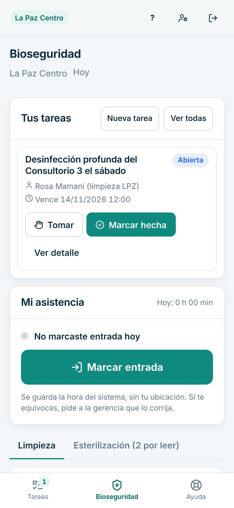
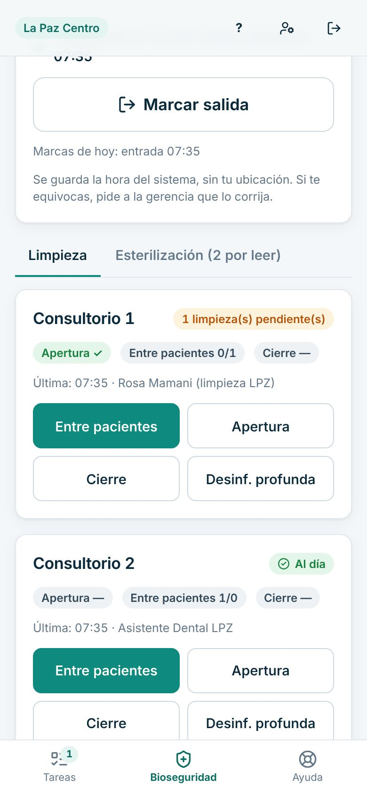
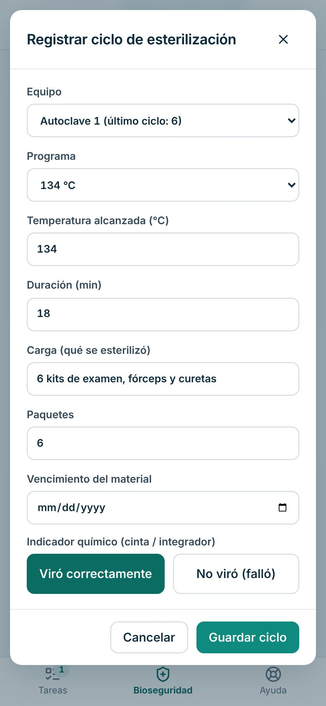
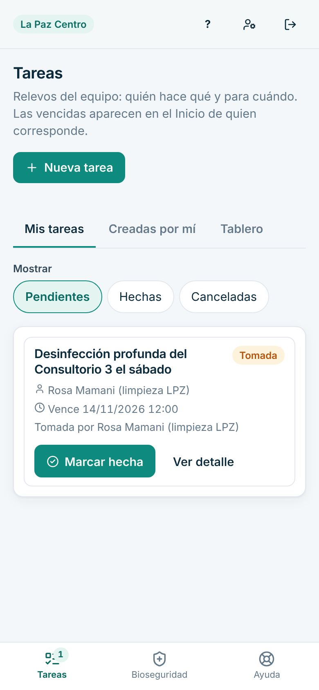

# Manual de Limpieza y apoyo

Para el personal de limpieza y esterilización. Está pensado para usarlo **desde el celular**.

> Cada paso de este manual se probó en la clínica de demostración, con datos inventados. Lo marcado como «[La clínica completa: …]» lo define tu clínica.

## Cómo entrar

1. En el celular, abre el navegador y entra a: [La clínica completa: dirección web de Dentalia].
2. Escribe tu **Correo** y tu **Contraseña** y toca «Ingresar».
3. La primera vez el sistema te pide cambiar la contraseña temporal.
4. Si olvidaste la contraseña, toca «Olvidé mi contraseña» o pide ayuda a gerencia.

Consejo: en «Mi cuenta» (el ícono de persona, arriba) puedes agregar Dentalia a la pantalla de inicio del celular.

## Qué ves al entrar

Se abre directamente «Bioseguridad».

- **Tus tareas**: lo que te pidió el equipo.
- **Mi asistencia**: marcar entrada y salida.
- **Limpieza** de cada consultorio y de las áreas comunes.
- **Esterilización**: los ciclos del autoclave.
- Abajo, el menú: «Tareas», «Bioseguridad» y «Ayuda».

Tú no ves pacientes, agenda ni caja.

## Tu día a día

### 1. Marcar tu entrada

1. En «Mi asistencia», toca «Marcar entrada».
2. Si trabajas en varias sucursales, elige la «Sucursal».

Se guarda la hora del sistema, sin tu ubicación.

### 2. Registrar la limpieza de un consultorio

1. En la pestaña «Limpieza», busca el consultorio.
2. Toca la tarea que hiciste: «Apertura», «Entre pacientes», «Cierre» o «Desinf. profunda».
3. Aparece «Registrado» abajo. Listo.

### 3. Registrar la limpieza de áreas comunes

1. En «Áreas comunes», elige el «Área» (por ejemplo «Baños» o «Sala de espera»).
2. Toca la tarea: «Limpieza general», «Desinfección profunda», «Retiro de residuos» o «Derrame / contingencia».

### 4. Registrar un ciclo de esterilización

1. Toca la pestaña «Esterilización».
2. Toca «Registrar ciclo».
3. Completa «Carga (qué se esterilizó)» y «Paquetes». Revisa «Equipo», «Programa», «Temperatura alcanzada (°C)» y «Duración (min)».
4. En «Indicador químico», toca «Viró correctamente» o «No viró (falló)».
5. Toca «Guardar ciclo».

Parámetros de tu autoclave: [La clínica completa: programa, temperatura y tiempo].

### 5. Anotar el indicador biológico

1. En «Esterilización», busca el ciclo con «Registrar».
2. Toca «Registrar».
3. Elige «Negativo (sin crecimiento)» o «Positivo (crecimiento)».
4. Toca «Guardar». Este registro no se puede modificar.

### 6. Hacer tus tareas

1. Toca «Tareas» abajo.
2. Toca «Tomar» en la tarea que vas a hacer.
3. Al terminar, «Marcar hecha».

### 7. Marcar tu salida

1. Vuelve a «Bioseguridad».
2. En «Mi asistencia», toca «Marcar salida».

## Si algo sale mal

- **El indicador químico no viró o el biológico salió positivo.** No uses esa carga. Avisa de inmediato a gerencia. El sistema muestra el aviso en rojo arriba.
- **Toqué la tarea equivocada.** No se borra. Avisa a gerencia. [La clínica completa: cómo se corrige]
- **Olvidé marcar la entrada o la salida.** Pide a gerencia que lo corrija.
- **Se cortó internet.** Aparece «Sin conexión a internet…». Anota en papel la hora y la tarea y regístrala cuando vuelva.
- **No me deja entrar.** Revisa el correo y la contraseña. Pide a gerencia «Restablecer contraseña».

## Lo que no puedes hacer en el sistema

| Necesitas | Pídeselo a |
|---|---|
| Corregir una marca de entrada o salida | Gerencia |
| Agregar un autoclave nuevo | Gerencia |
| Ver datos de pacientes o la agenda | No corresponde a tu puesto |
| Pedir insumos de limpieza | [La clínica completa: a quién pedirlos] |

Para imprimir lo esencial, usa la [hoja de una página](chuleta-limpieza.md).
