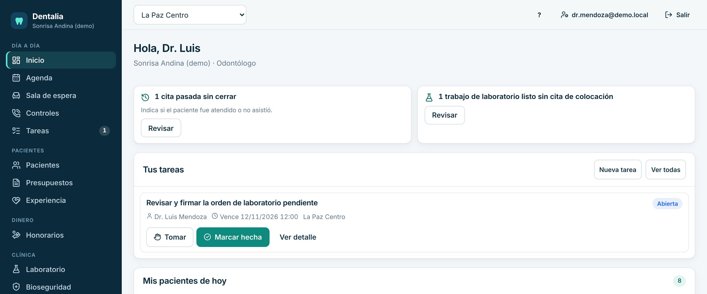
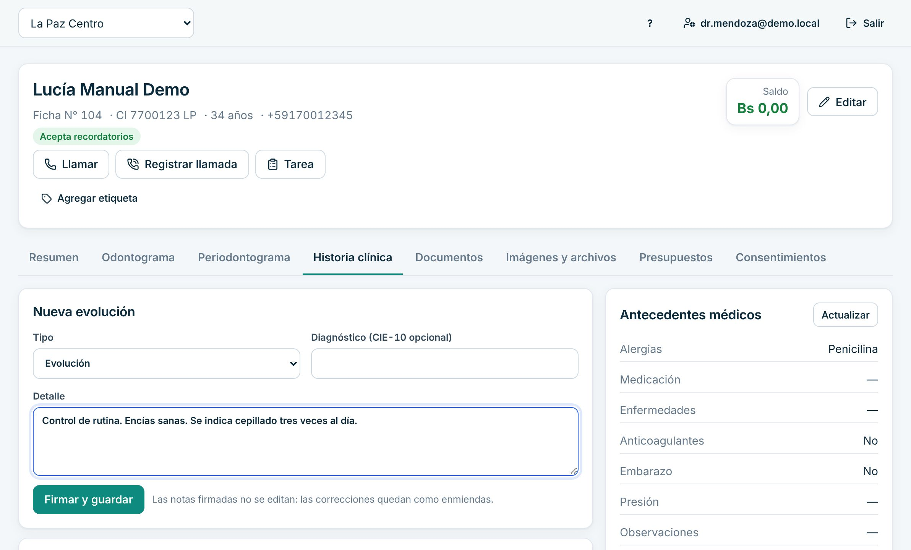
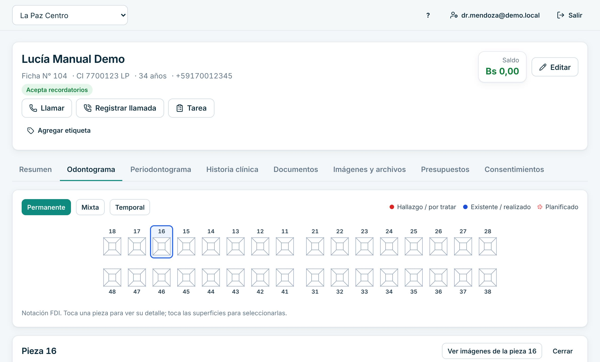
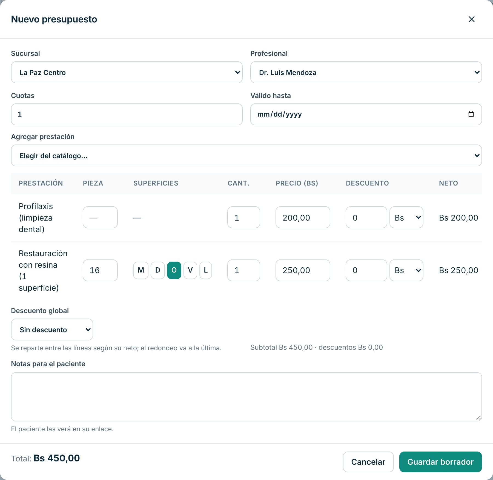
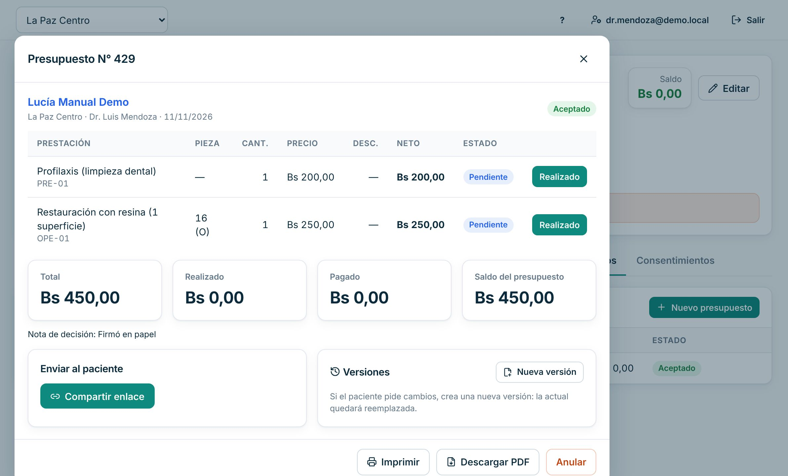
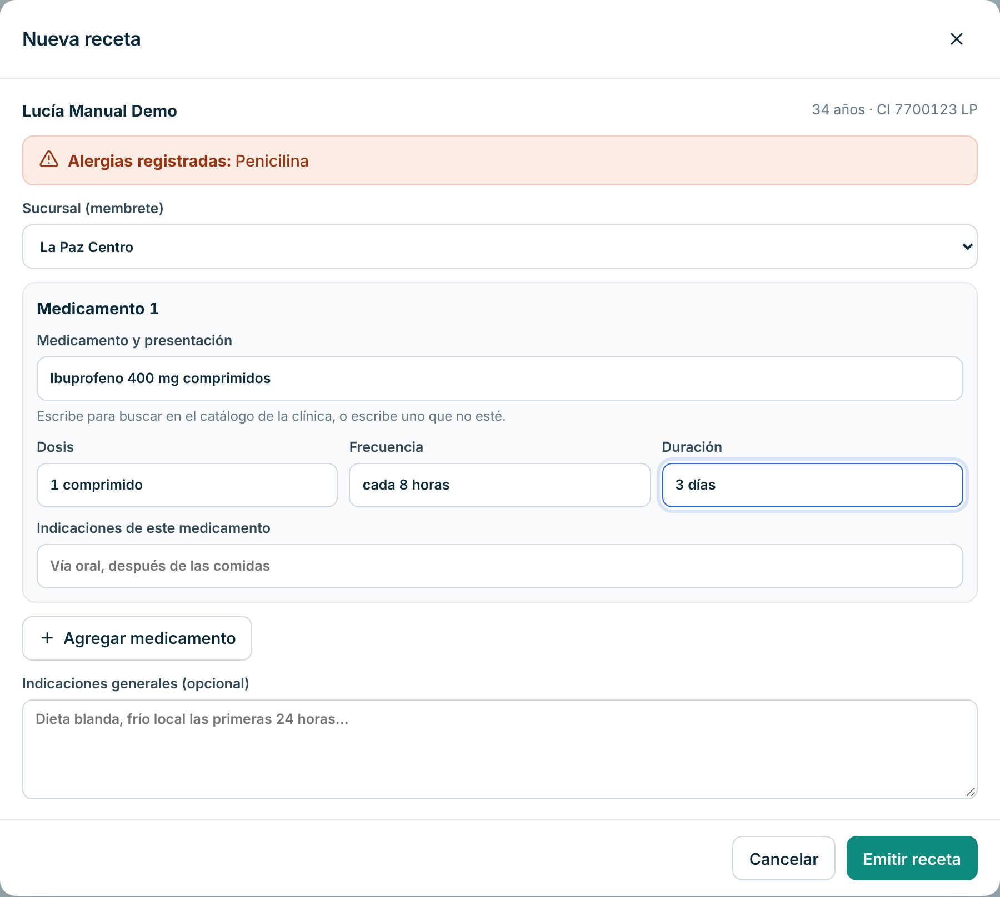
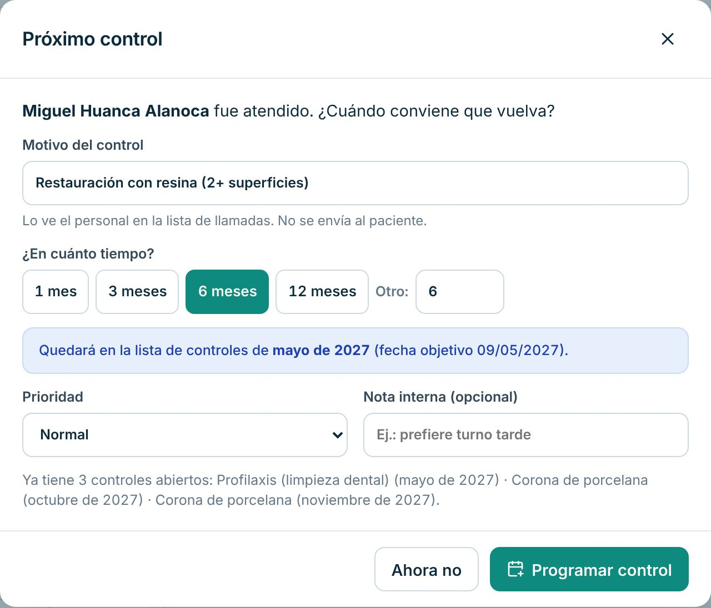
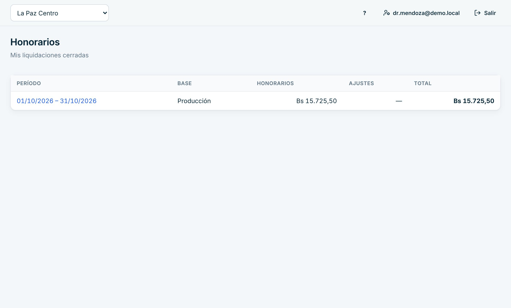

# Manual del Odontólogo

Para odontólogas y odontólogos que atienden en la clínica: tu día, la ficha clínica, presupuestos, tratamientos y recetas.

> Cada paso de este manual se probó en la clínica de demostración, con datos inventados. Lo marcado como «[La clínica completa: …]» lo define tu clínica.

## Cómo entrar

1. Abre Dentalia en el navegador: [La clínica completa: dirección web de Dentalia].
2. Escribe tu **Correo** y tu **Contraseña** y pulsa «Ingresar».
3. La primera vez el sistema te pide cambiar la contraseña temporal.
4. Si olvidaste la contraseña, pulsa «Olvidé mi contraseña».

Si atiendes en más de una sucursal, elige la sucursal arriba, en el selector de la barra superior.

## Qué ves al entrar

- **Avisos para hoy**: huecos libres, citas pasadas sin cerrar, trabajos de laboratorio listos.
- **Tus tareas**: pendientes que te dejó el equipo.
- **Mis pacientes de hoy**: hora, paciente, prestación, sucursal, consultorio y alertas médicas (por ejemplo alergias o anticoagulantes).
- **Citas de hoy** de la sucursal.

## Tu día a día

### 1. Abrir la ficha del paciente

1. En el Inicio, en «Mis pacientes de hoy», pulsa el nombre del paciente.
2. También puedes llegar desde la Agenda (pulsa la cita y luego el nombre) o desde «Pacientes».

La ficha tiene pestañas: «Resumen», «Odontograma», «Periodontograma», «Historia clínica», «Documentos», «Imágenes y archivos», «Presupuestos» y «Consentimientos».

### 2. Revisar y actualizar los antecedentes médicos

1. En la ficha, abre «Historia clínica».
2. A la derecha ves «Antecedentes médicos»: alergias, medicación, enfermedades, anticoagulantes, embarazo, presión.
3. Si algo cambió, pulsa «Actualizar», corrige y pulsa «Guardar versión».

Cada cambio queda como una versión nueva, con fecha y autor.

### 3. Registrar la evolución

1. En «Historia clínica», bajo «Nueva evolución», elige el «Tipo».
2. Si corresponde, escribe el «Diagnóstico (CIE-10 opcional)».
3. Escribe el «Detalle»: motivo, hallazgos, procedimiento e indicaciones.
4. Pulsa «Firmar y guardar».

Las notas firmadas no se editan. Si te equivocaste, pulsa «Enmendar» en la nota: la original se conserva y la corrección queda como enmienda.

### 4. Marcar en el odontograma

1. Abre la pestaña «Odontograma».
2. Pulsa la pieza (notación FDI).
3. En «Registrar», elige la «Condición / tratamiento», las «Superficies» si corresponde y el «Estado»: «Existente», «Planificado» o «Realizado».
4. Pulsa «Guardar en pieza N».

Para quitar una marca equivocada, pulsa «Anular» en «Estado actual» de esa pieza.

### 5. Hacer un presupuesto

1. En la ficha, pestaña «Presupuestos», pulsa «Nuevo presupuesto».
2. En «Agregar prestación», elige del catálogo. Repite para cada tratamiento.
3. Si el tratamiento es por pieza, escribe la «Pieza»; si es por superficie, pulsa las letras (M, D, O, V, L).
4. Revisa cantidades, precios y descuentos. Abajo ves el «Total».
5. Pulsa «Guardar borrador».

Descuentos: [La clínica completa: hasta cuánto puede descontar el odontólogo y quién autoriza más].

### 6. Presentar el presupuesto y registrar que el paciente aceptó

1. Abre el presupuesto (pulsa su fila en la pestaña «Presupuestos»).
2. Pulsa «Marcar como presentado» cuando se lo explicaste al paciente.
3. Puedes entregarlo con «Compartir enlace», «Entregado en mano» o «Imprimir».
4. Cuando el paciente acepta, pulsa «Paciente aceptó», escribe cómo aceptó en «Nota (opcional)» y pulsa «Confirmar».

Si el paciente pide cambios, usa «Nueva versión»: la versión anterior queda reemplazada.

### 7. Registrar un tratamiento realizado

1. En el presupuesto aceptado, busca la línea del tratamiento.
2. Pulsa «Realizado» (o «Sesión realizada» si el tratamiento es por sesiones).

Al marcarlo realizado se genera el cargo en la cuenta del paciente.

### 8. Emitir una receta

1. En la ficha, abre «Documentos» y pulsa «Nueva receta».
2. Arriba ves las alergias registradas del paciente. Elige la «Sucursal (membrete)».
3. Para cada medicamento completa «Medicamento y presentación», «Dosis», «Frecuencia» y «Duración». Usa «Agregar medicamento» para otro.
4. Pulsa «Emitir receta» y confirma con «Emitir».
5. Pulsa «PDF» para descargarla, imprimirla o enviarla.

Si el paciente tiene una alergia registrada que coincide, el sistema avisa y te pide marcar «Revisé la alergia» para emitir igual. Una receta emitida no se edita: para corregirla, «Anular» con el motivo y «Reemitir corregido». En «Documentos» también está «Nuevo certificado».

Requisitos de la receta en tu clínica: [La clínica completa: datos obligatorios, sello o firma en papel].

### 9. Terminar la atención y programar el próximo control

1. Abre «Sala de espera». Cuando el paciente entra, «Pasar a atención».
2. Al terminar, «Atendido».
3. Se abre «Próximo control»: escribe el «Motivo del control», elige en cuánto tiempo (1, 3, 6 o 12 meses) y pulsa «Programar control». Si no hace falta, «Ahora no».

El control queda en la lista de llamadas de recepción. No se envía nada al paciente desde aquí.

Si en «Citas pasadas sin cerrar» queda una cita tuya de otro día, pulsa «Atendida» o «No asistió».

### 10. Ver tus honorarios

1. Abre «Honorarios».
2. Ves tus liquidaciones **cerradas** por período: base, honorarios, ajustes y total. Pulsa el período para ver el detalle.

El porcentaje y la base de cálculo los define la clínica: [La clínica completa: regla de honorarios y fechas de pago].

## Si algo sale mal

- **Firmé una evolución con un error.** Pulsa «Enmendar» en esa nota y escribe la corrección. La nota original no se borra.
- **Marqué «Realizado» por error.** No hay botón para deshacerlo. Avisa a gerencia: puede anular el cargo con un motivo. [La clínica completa: cómo se corrige el odontograma en ese caso]
- **Emití una receta con un error.** «Anular» con motivo y «Reemitir corregido».
- **El paciente no aparece en mi Inicio.** Revisa la sucursal elegida arriba. Búscalo en «Pacientes» por nombre, CI o N° de ficha.
- **Se cortó internet.** Arriba aparece «Sin conexión a internet…». No se guarda nada hasta que vuelva. Anota en papel y registra al volver la conexión.
- **Una alergia no aparece en la receta.** Revisa «Antecedentes médicos» y actualízalos con «Actualizar».

## Lo que no puedes hacer en el sistema

| Necesitas | Pídeselo a |
|---|---|
| Cobrar al paciente o entregar recibos | Recepción o caja |
| Anular un cargo o un pago | Gerencia |
| Cerrar o pagar una liquidación de honorarios | Gerencia (contabilidad la prepara) |
| Cambiar precios del catálogo | Gerencia o la dueña |
| Cambiar tu horario de atención | Gerencia |
| Ver informes de dinero de toda la clínica | Contabilidad o gerencia |

Para imprimir lo esencial, usa la [hoja de una página](chuleta-odontologo.md).
