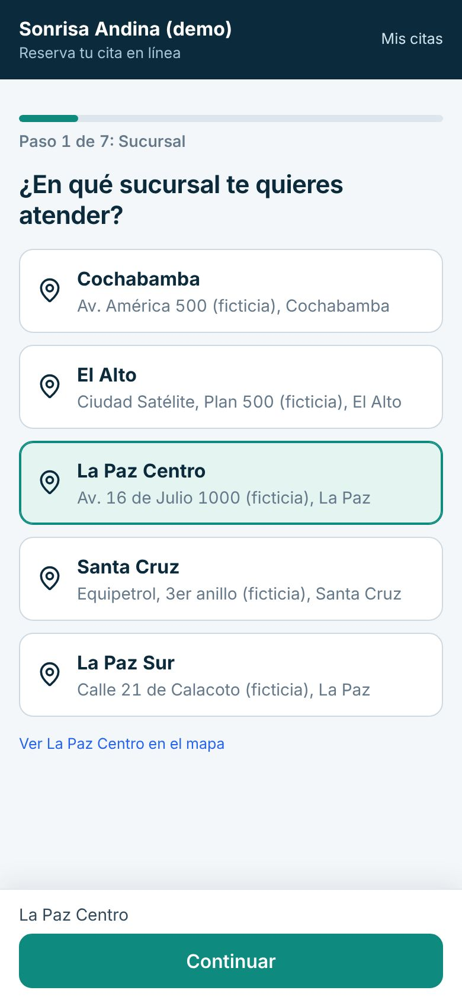
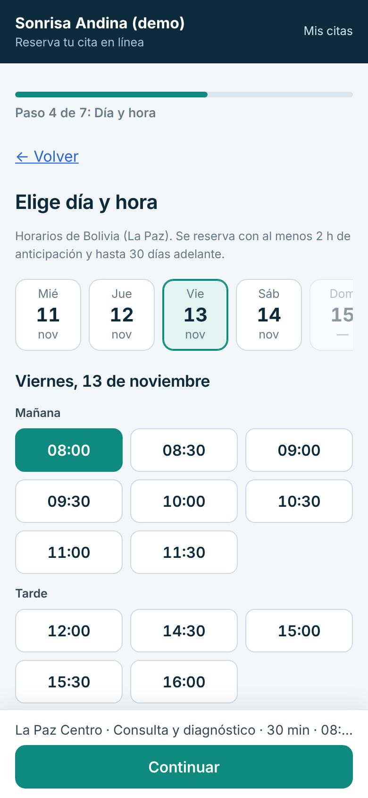
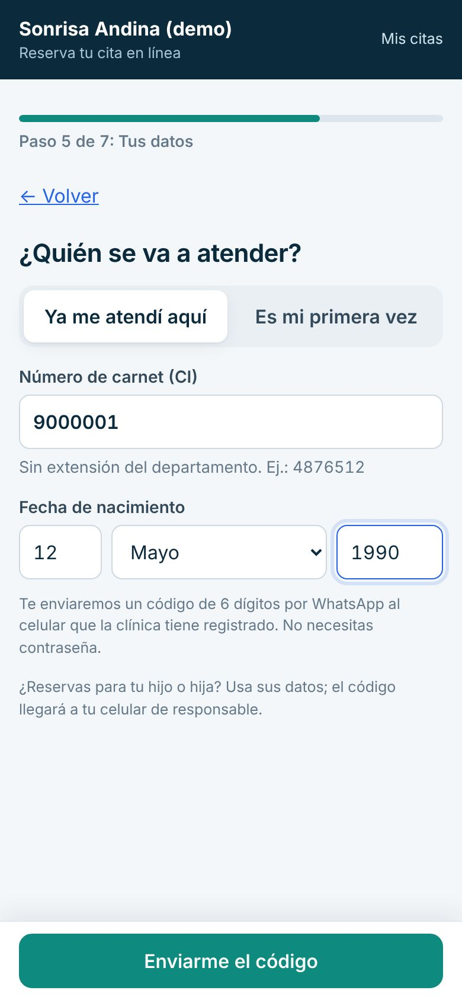
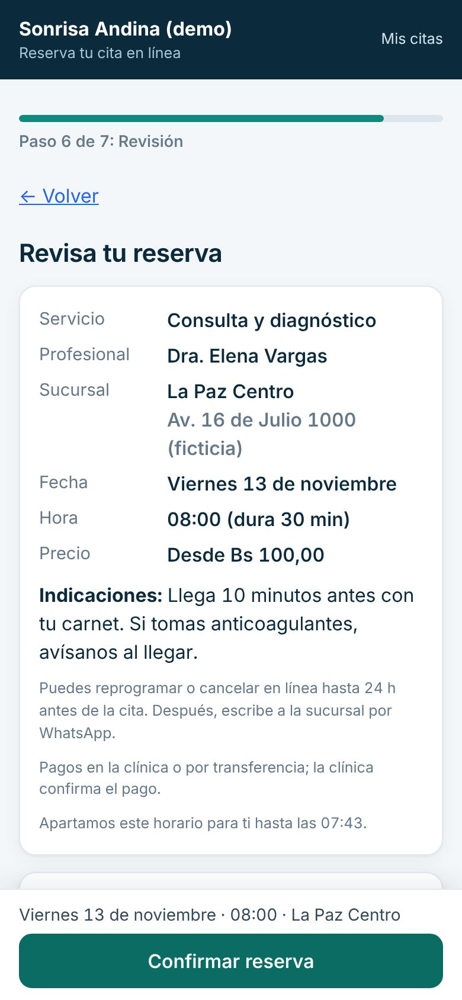
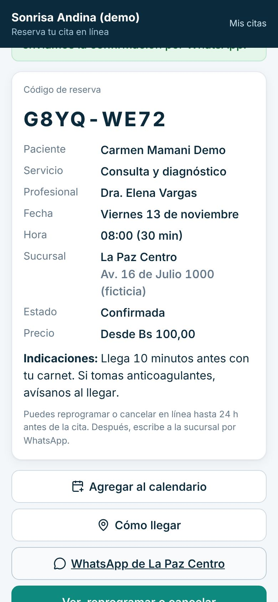
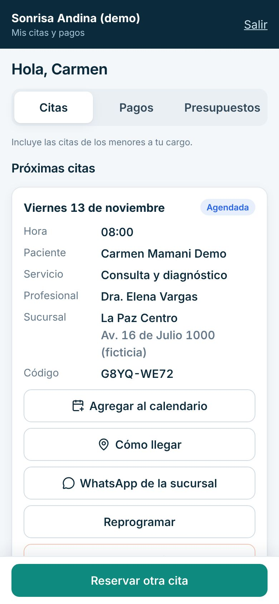
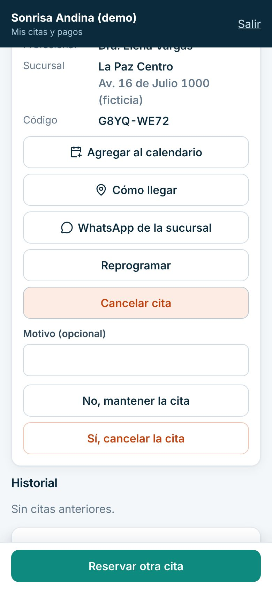
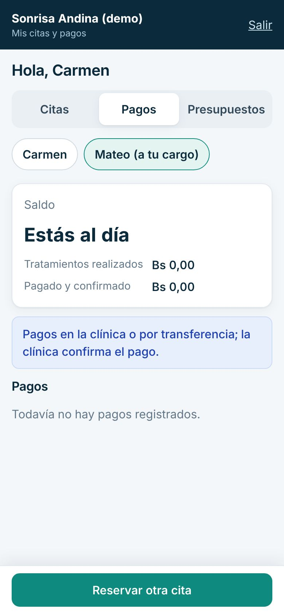

# Guía del portal del paciente

Para pacientes, mamás, papás y responsables. Con el portal reservas tu cita desde el celular y ves tus citas, pagos y presupuestos. No necesitas contraseña: te llega un código por WhatsApp.

> Cada paso de esta guía se probó en la clínica de demostración, con datos inventados. Lo marcado como «[La clínica completa: …]» lo define tu clínica.

## Dónde entrar

- Para **reservar una cita**: [La clínica completa: enlace de reserva, por ejemplo el que está en su WhatsApp o redes].
- Para **ver tus citas y pagos** («Mi cuenta»): [La clínica completa: enlace de Mi cuenta].

## Reservar una cita

1. Abre el enlace de reserva. Elige la **sucursal** y toca «Continuar».

2. Elige qué necesitas (por ejemplo «Consulta y diagnóstico») y toca «Continuar».
3. Elige con quién te quieres atender, o «Cualquier profesional», y toca «Ver horarios».
4. Elige el **día** y la **hora** y toca «Continuar».

5. Di quién se va a atender:
   - si ya te atendiste en la clínica, toca «Ya me atendí aquí» y escribe tu número de carnet (CI) y tu fecha de nacimiento;
   - si es tu primera vez, toca «Es mi primera vez» y completa tus datos. Para un menor, se piden los datos de la madre, el padre o el responsable.
6. Toca «Enviarme el código».

7. Te llega un código de 6 dígitos por WhatsApp. Escríbelo en «Código de 6 dígitos» y toca «Verificar código». El código vence en 10 minutos.
8. Revisa tu reserva. Si tienes hijos a tu cargo, elige para quién es la cita. Toca «Confirmar reserva» (o «Enviar solicitud»). Si es tu primera vez, se te pide autorizar el uso de tus datos personales.

9. ¡Listo! Ves el **código de tu reserva**, y los botones «Agregar al calendario», «Cómo llegar» y el WhatsApp de la sucursal.

En algunas sucursales la cita queda como **solicitud**: la clínica la revisa y te avisa. [La clínica completa: en qué sucursales se confirma al instante]

## Ver, reprogramar o cancelar tu cita

1. Entra a «Mi cuenta» (o toca «Ver, reprogramar o cancelar» al terminar tu reserva).
2. Escribe tu carnet y tu fecha de nacimiento, toca «Enviarme el código» y escribe el código que te llega por WhatsApp.
3. En «Citas» ves tus «Próximas citas» y el «Historial».

- Para **cambiar el horario**, toca «Reprogramar», elige otro horario y toca «Confirmar el cambio».
- Para **cancelar**, toca «Cancelar cita» y luego «Sí, cancelar la cita».

Puedes reprogramar o cancelar en línea solo hasta cierto tiempo antes de la cita: [La clínica completa: horas de anticipación]. Después, escribe a la sucursal por WhatsApp.

## Si eres mamá, papá o responsable

- En «Citas» aparecen también las citas de los menores a tu cargo.
- En «Pagos» y «Presupuestos», toca arriba el nombre de tu hijo o hija (por ejemplo «Mateo (a tu cargo)») para ver lo suyo.

Para que tu hijo aparezca aquí, la clínica debe tenerte registrado como su responsable, con tu celular. [La clínica completa: cómo pedirlo]

## Ver tus pagos y presupuestos

- En «Pagos» ves lo que pagaste. Los pagos se hacen en la clínica o por transferencia, y la clínica los confirma.
- En «Presupuestos» ves tus presupuestos. Solo se pueden ver; para cambiarlos, habla con tu odontólogo.

Formas de pago aceptadas: [La clínica completa: efectivo, QR, transferencia, cuenta bancaria].

## Dejar de recibir mensajes

En «Mi cuenta», en «Mensajes de la clínica», toca «Dejar de recibir mensajes». Verás «Listo: ya no te enviaremos recordatorios ni promociones». Si cambias de opinión, avisa en la clínica.

## Salir

Toca «Salir», arriba a la derecha. Si usas un celular prestado, sal siempre al terminar.

## Si algo sale mal

- **No me llega el código.** Espera un minuto y toca «Pedir otro código». Si sigue sin llegar, toca «Escribe a la sucursal por WhatsApp».
- **Dice «Código incorrecto».** Revisa los 6 números. Tienes pocos intentos; si se acaban, pide otro código.
- **No me reconoce con mi carnet.** Escribe el carnet sin la extensión del departamento (por ejemplo 4876512, no 4876512 LP) y revisa la fecha de nacimiento. Si es tu primera vez, usa «Es mi primera vez».
- **No veo a mi hijo.** La clínica debe registrarte como su responsable con tu celular. Pídelo en recepción.
- **Ya no puedo reprogramar en línea.** Escribe a la sucursal por WhatsApp o llama: [La clínica completa: teléfonos de cada sucursal].

## Lo que el portal no hace

- No muestra tu historia clínica, radiografías ni recetas. Pídelas en la clínica.
- No recibe pagos en línea.
- No cambia tus datos personales: pídelo en recepción.
