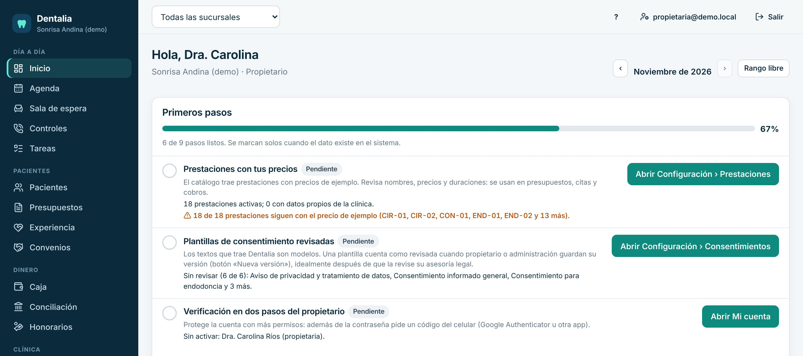
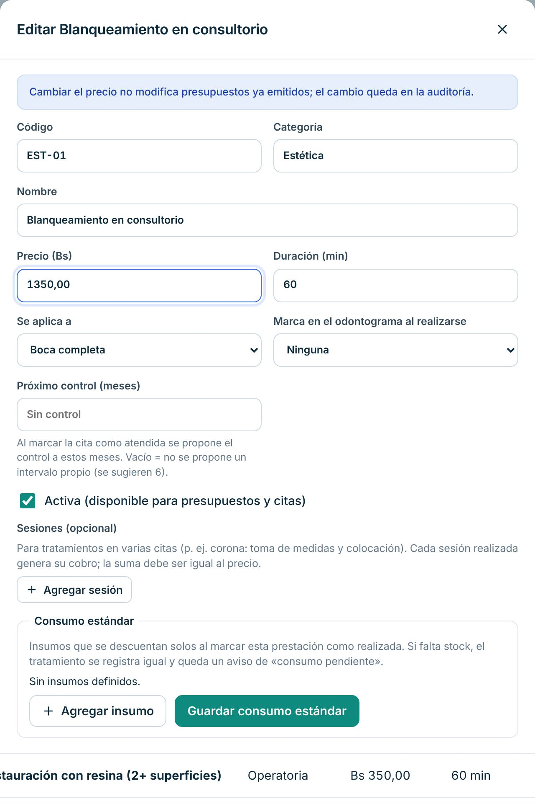
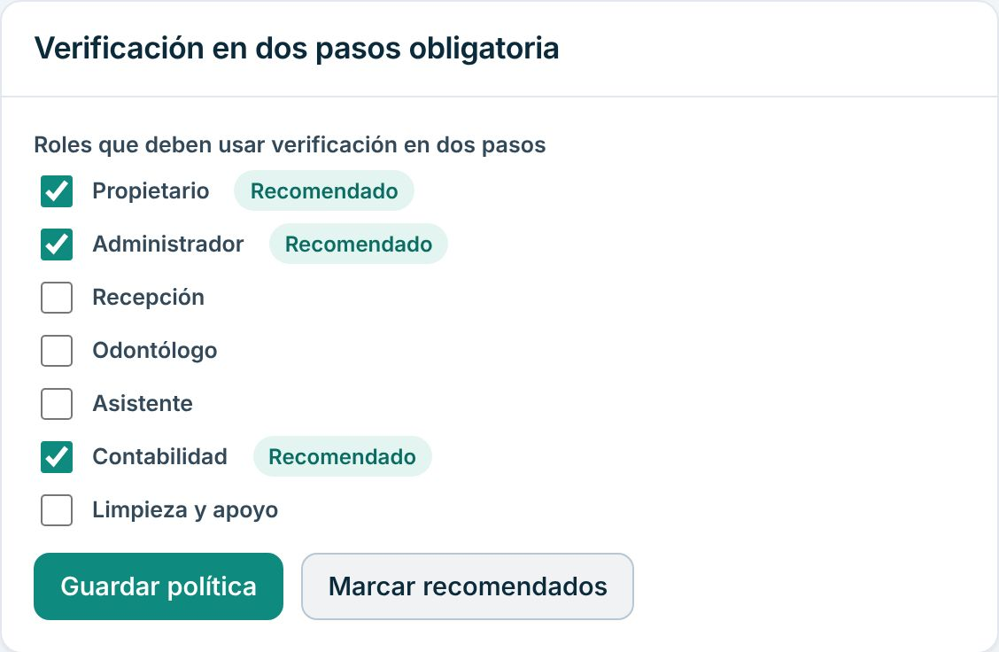
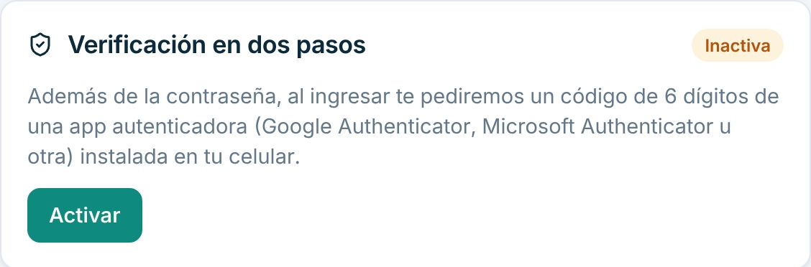
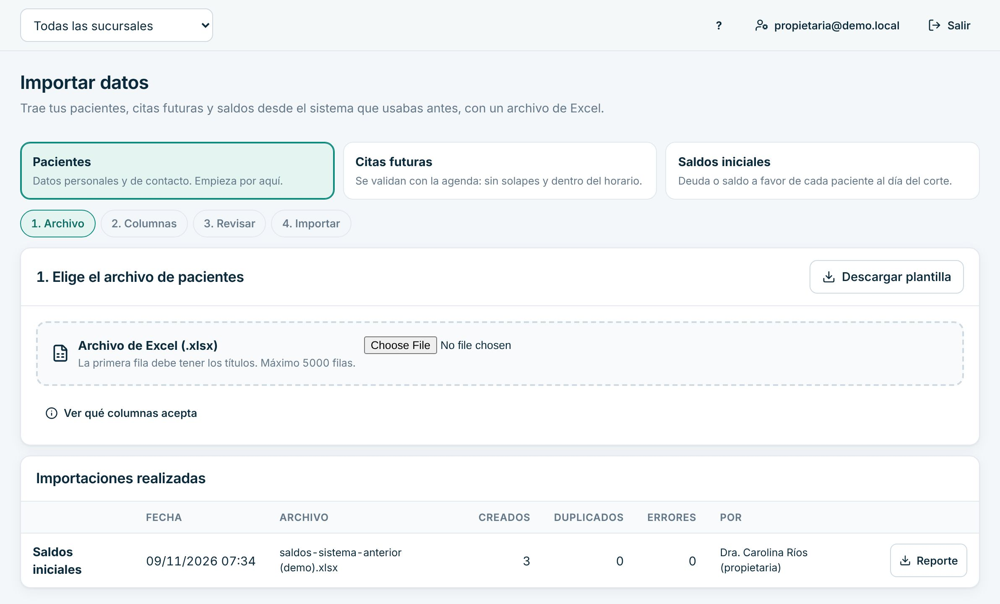

# Manual de la dueña o el dueño

Para quien es propietaria o propietario de la clínica. En el sistema tu rol es **Propietario**: ves todo, pones en marcha la clínica, defines precios y seguridad y sigues los resultados. Para el trabajo diario de corrección y equipo, mira también el [manual de Gerencia](gerencia.md).

> Cada paso de este manual se probó en la clínica de demostración, con datos inventados. Lo marcado como «[La clínica completa: …]» lo define tu clínica.

## Cómo entrar

1. Abre Dentalia en el navegador: [La clínica completa: dirección web de Dentalia].
2. Escribe tu **Correo** y tu **Contraseña** y pulsa «Ingresar».
3. Activa cuanto antes la verificación en dos pasos (ver la tarea 5).

## Qué ves al entrar

- **Primeros pasos**: la lista para poner en marcha la clínica, con el porcentaje de avance. Cada paso se marca solo cuando el dato ya existe en el sistema.
- Más abajo, los números del mes por sucursal y la comparación con el período anterior.
- El menú completo: día a día, pacientes, dinero, clínica, gestión y ajustes.

## Tu día a día

### 1. Poner en marcha la clínica con «Primeros pasos»

1. En el Inicio, revisa «Primeros pasos». Cada paso dice qué falta.
2. Pulsa el botón del paso (por ejemplo «Abrir Configuración › Prestaciones»): te lleva a la pantalla exacta.
3. Completa el dato y vuelve al Inicio: el paso se marca «Listo».
4. Cuando todo esté completo, aparece «Ocultar del Inicio».

Incluye: datos de la clínica, sucursales y consultorios, personal, horarios, prestaciones con tus precios, tipos de cita, consentimientos revisados, verificación en dos pasos y pacientes.

### 2. Poner tus precios

1. Abre «Configuración», pestaña «Prestaciones».
2. En la prestación, pulsa «Editar».
3. Cambia el «Precio (Bs)» y lo que necesites (duración, nombre).
4. Pulsa «Guardar».

El catálogo trae precios de ejemplo. «Primeros pasos» te avisa cuántas prestaciones siguen con el precio de ejemplo. Lista de precios de la clínica: [La clínica completa: lista de precios aprobada].

### 3. Revisar los consentimientos

1. Abre «Configuración», pestaña «Consentimientos».
2. Revisa cada texto con tu asesoría legal antes de usarlo.
3. Guarda tu versión con «Nueva versión».

Los textos que trae Dentalia son modelos. Este manual no opina sobre su alcance legal: eso lo define tu asesoría. [La clínica completa: quién revisó los consentimientos y cuándo]

### 4. Exigir verificación en dos pasos al equipo

1. Abre «Configuración», pestaña «Seguridad». Solo la dueña la ve.
2. Marca los roles que deben usarla, o pulsa «Marcar recomendados».
3. Pulsa «Guardar política».

Esas personas deberán activarla en su próximo ingreso.

### 5. Activar tu verificación en dos pasos

1. Pulsa tu correo, arriba a la derecha: se abre «Mi cuenta».
2. En «Verificación en dos pasos», pulsa «Activar».
3. Escribe tu contraseña en «Confirma tu contraseña» y pulsa «Continuar».
4. Escanea el código con una app de autenticación del celular (por ejemplo Google Authenticator). Si no puedes escanear, escribe la clave que aparece.
5. Escribe el «Código de 6 dígitos» de la app y pulsa «Confirmar y activar».
6. Guarda los códigos de recuperación en un lugar seguro y pulsa «Ya los guardé».

### 6. Traer los datos del sistema anterior

1. Abre «Importar datos». Empieza por «Pacientes»; luego «Citas futuras» y «Saldos iniciales».
2. Si tu sistema anterior exporta a Excel, usa ese archivo. Si no, pulsa «Descargar plantilla» y copia tus datos en ella.
3. Elige el archivo y revisa qué columna corresponde a cada dato.
4. Pulsa «Revisar»: ves cuántos se crearán, cuántos están duplicados y qué filas tienen errores.
5. Corrige y pulsa «Importar». Confirma el número exacto.

Importar dos veces el mismo archivo no duplica. La historia clínica, los odontogramas y las radiografías no se importan.

### 7. Ver cómo va la clínica

- **Inicio:** cobrado, producción, cuentas por cobrar y citas del mes, por sucursal. «Rango libre» compara otras fechas con el período anterior.
- **Gestión › Rentabilidad:** ingresos, costos, gastos y margen por sucursal y sillón.
- **Reportes:** exportaciones a Excel.
- **Actividad:** quién hizo qué y cuándo.

Las imágenes de Rentabilidad están en el [manual de Gerencia](gerencia.md).

### 8. El equipo y las correcciones

Tú también puedes agregar personal, anular pagos y cerrar liquidaciones de honorarios. Los pasos están en el [manual de Gerencia](gerencia.md).

## Si algo sale mal

- **Un paso de «Primeros pasos» no se marca.** Lee lo que dice debajo: indica qué dato falta.
- **Importé un saldo inicial equivocado.** En la ficha del paciente, «Cuenta y pagos», en «Saldo inicial (sistema anterior)» pulsa «Anular» con el motivo. Luego vuelve a importarlo.
- **Alguien del equipo perdió el celular con la app de dos pasos.** [La clínica completa: procedimiento y a quién avisar]
- **Se cortó internet.** No se guarda nada hasta que vuelva. [La clínica completa: plan de contingencia de la clínica]
- **Sospechas de un uso indebido.** Revisa «Actividad» y la pestaña «Auditoría» de «Configuración».

## Lo que no puedes hacer en el sistema

| Necesitas | Pídeselo a |
|---|---|
| Registrar limpieza o esterilización (tu rol solo la consulta) | Asistentes o limpieza |
| Firmar evoluciones o recetas (salvo que también atiendas y tengas marcado «Atiende pacientes») | El odontólogo |
| Cambiar tu plan de Dentalia | [La clínica completa: contacto comercial de Dentalia] |
| Facturación fiscal | [La clínica completa: sistema de facturación] |

Para imprimir lo esencial, usa la [hoja de una página](chuleta-propietaria.md).
