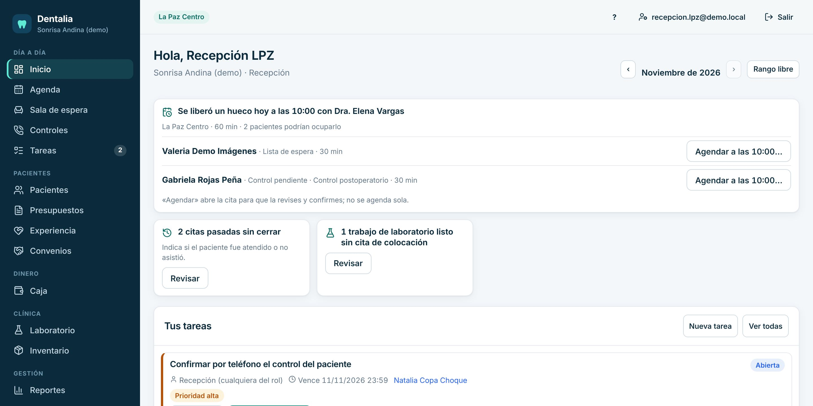
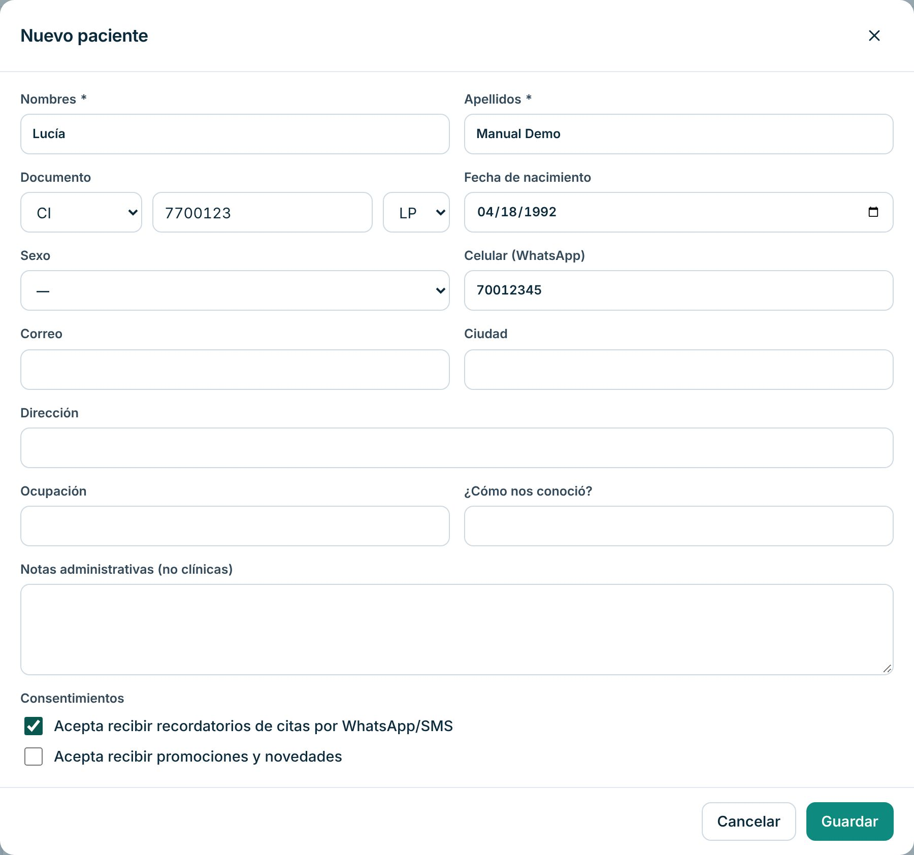
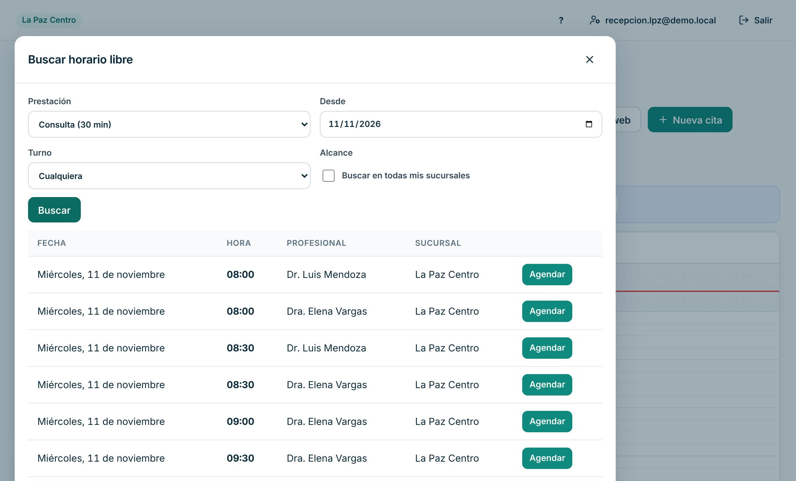
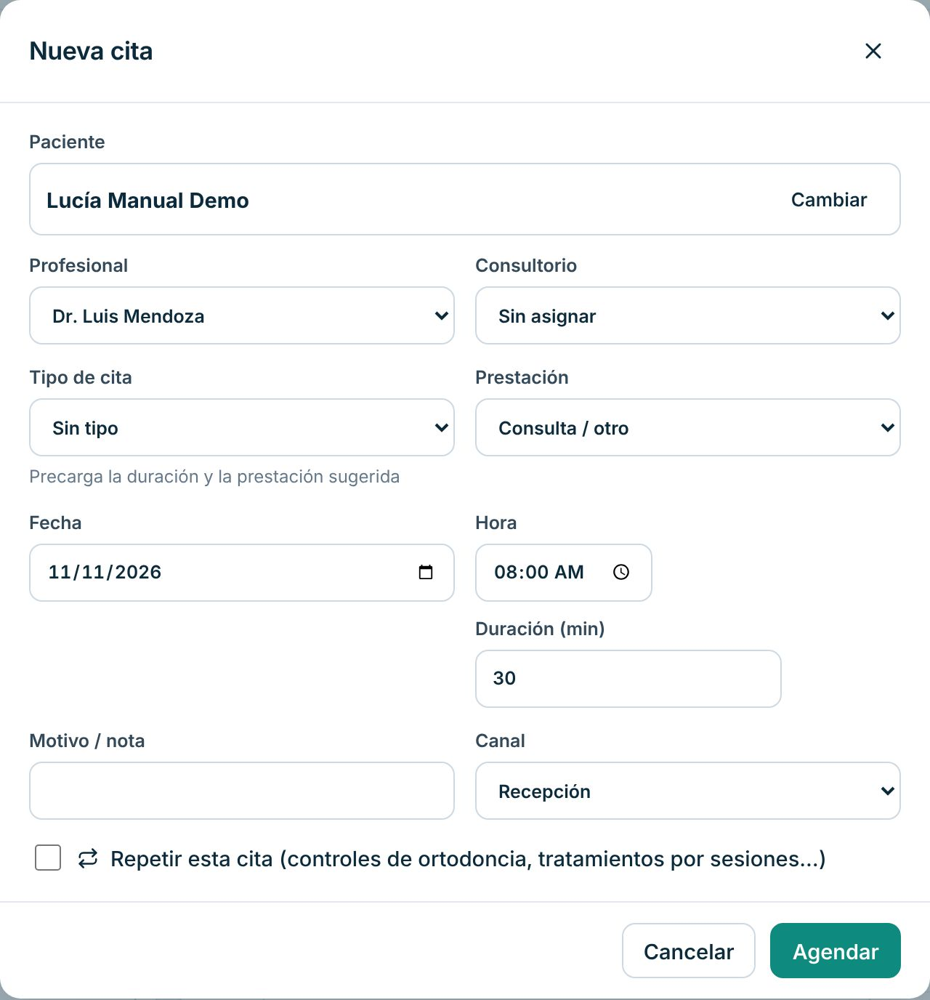
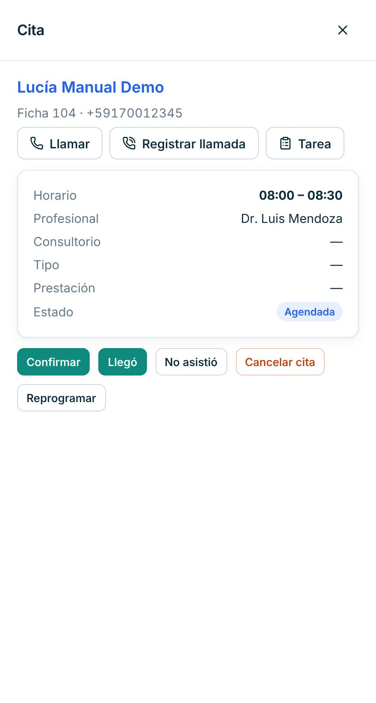
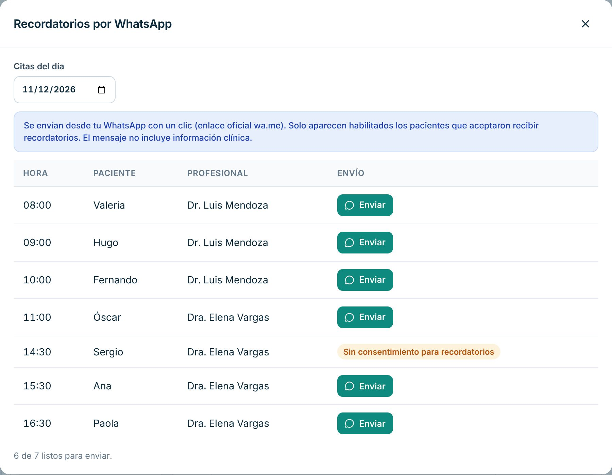
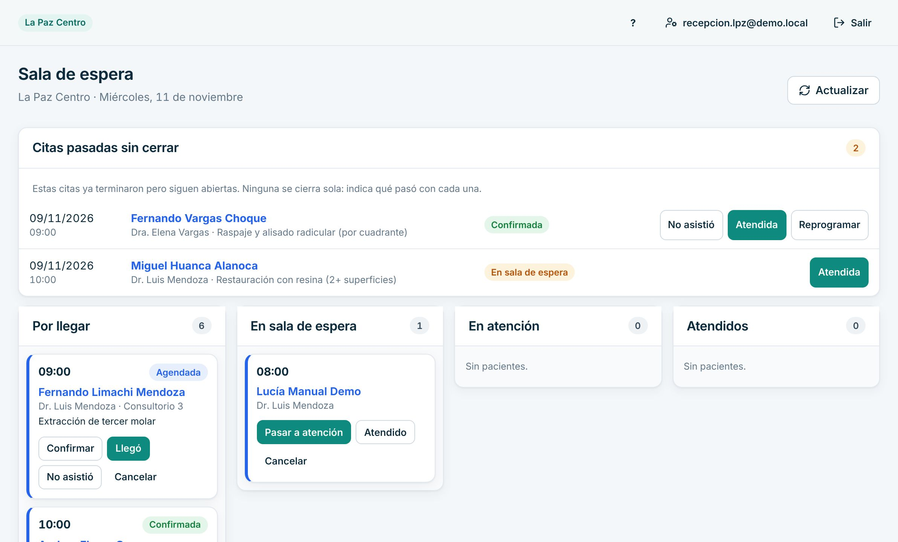
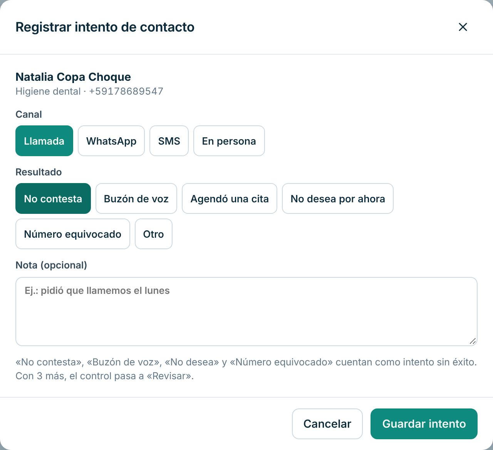
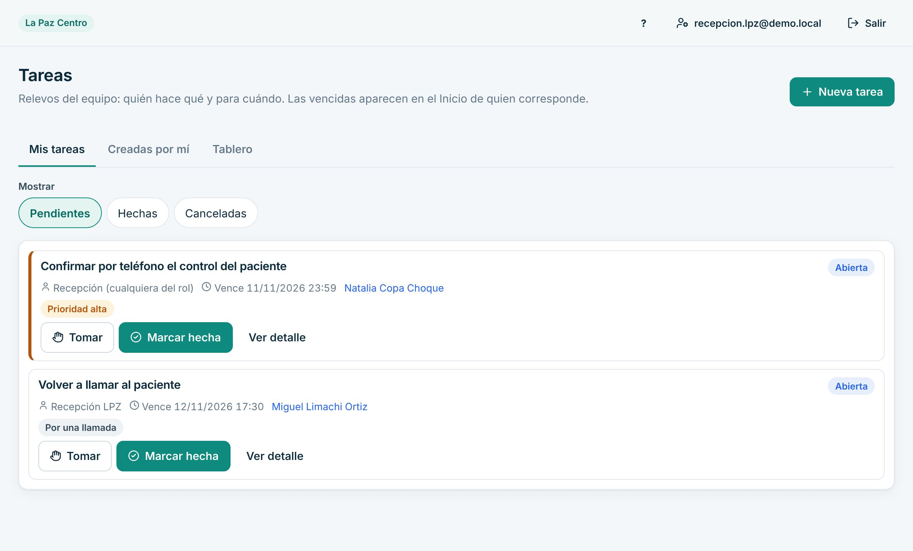

# Manual de Recepción

Para quien atiende el mostrador: agenda, pacientes, sala de espera y llamadas. Si además cobras, lee también el [manual de Caja](caja.md).

> Cada paso de este manual se probó en la clínica de demostración, con datos inventados. Lo marcado como «[La clínica completa: …]» lo define tu clínica.

## Cómo entrar

1. Abre Dentalia en el navegador: [La clínica completa: dirección web de Dentalia].
2. Escribe tu **Correo** y tu **Contraseña** y pulsa «Ingresar».
3. La primera vez el sistema te pide cambiar la contraseña temporal. Elige una que solo tú sepas.
4. Si olvidaste la contraseña, pulsa «Olvidé mi contraseña» y luego «Enviar enlace». El enlace llega a tu correo y sirve 30 minutos.

Tu usuario es solo tuyo. No lo prestes ni uses el de otra persona: el sistema guarda quién hizo cada cosa.

## Qué ves al entrar

- **Arriba a la izquierda**, el nombre de tu sucursal.
- **Avisos para hoy**: huecos que se liberaron, citas pasadas sin cerrar y trabajos de laboratorio listos. Cada aviso tiene su botón «Revisar».
- **Tus tareas**: pendientes que te dejó el equipo.
- **Mi asistencia**: para marcar tu entrada y salida (solo si gerencia te activó el fichaje).
- **Citas de hoy** de tu sucursal, más abajo.
- **El menú** de la izquierda. En el celular, abajo, y el resto en «Más».
- **El botón «?»** de arriba abre la ayuda de la pantalla donde estás.

## Tu día a día

### 1. Marcar tu entrada y salida

1. En el Inicio, busca la tarjeta «Mi asistencia».
2. Al llegar, pulsa «Marcar entrada».
3. Al irte, pulsa «Marcar salida».

Se guarda la hora del sistema, sin tu ubicación. Si te equivocas, pide a gerencia que lo corrija.

### 2. Registrar un paciente nuevo

1. Abre «Pacientes» y pulsa «Nuevo paciente».
2. Completa «Nombres *» y «Apellidos *».
3. En «Documento» elige el tipo y escribe el número. Si no tiene, elige «Sin documento».
4. Escribe el «Celular (WhatsApp)» y la «Fecha de nacimiento».
5. Si es menor de edad, completa los datos del responsable.
6. Marca «Acepta recibir recordatorios…» o «Acepta recibir promociones…» **solo si el paciente lo aceptó**.
7. Pulsa «Guardar».

Si aparece «Ya hay pacientes parecidos», revisa esas fichas antes. Usa «Es otra persona: registrar igual» solo si estás segura de que no es el mismo paciente.

### 3. Buscar un paciente

1. Abre «Pacientes».
2. Escribe en el buscador el nombre, el CI, el celular o el N° de ficha.
3. Pulsa la fila del paciente para abrir su ficha.

### 4. Agendar una cita

La forma más rápida es pedirle al sistema un horario libre.

1. Abre «Agenda» y pulsa «Buscar horario».
2. Elige la «Prestación» y desde qué fecha buscar. Puedes elegir «Turno» (mañana o tarde).
3. Pulsa «Agendar» en el horario que le sirve al paciente.

4. En «Nueva cita», busca al paciente por nombre, CI, teléfono o N° de ficha. Si es nuevo, pulsa «Paciente nuevo».
5. Revisa «Profesional», «Fecha» y «Hora».
6. Pulsa «Agendar».

También puedes pulsar «Nueva cita» y llenar todo a mano. Si el horario ya está ocupado o fuera del horario del profesional, el sistema te avisa y no guarda.

### 5. Confirmar, reprogramar o cancelar una cita

1. En la Agenda, pulsa la cita.
2. Se abre el panel «Cita». Desde ahí puedes:
   - «Confirmar», cuando el paciente confirma que vendrá;
   - «Reprogramar»: eliges «Nueva fecha» y «Nueva hora» y pulsas «Guardar nuevo horario»;
   - «Cancelar cita»: escribes el motivo y pulsas «Confirmar cancelación».

También puedes arrastrar la cita a otro horario en la Agenda.

### 6. Enviar recordatorios por WhatsApp

1. En la Agenda, pulsa «Recordatorios».
2. En «Citas del día» elige la fecha.
3. Pulsa «Enviar» en cada paciente. Se abre WhatsApp con el mensaje listo; tú lo envías.

Solo aparecen habilitados los pacientes que aceptaron recibir recordatorios. El mensaje no lleva datos clínicos.

### 7. Recibir al paciente en la sala de espera

1. Abre «Sala de espera».
2. Cuando el paciente llega, pulsa «Llegó» en su tarjeta (columna «Por llegar»). Si no vino, «No asistió».
3. Cuando entra al consultorio, «Pasar a atención». Al terminar, «Atendido».
4. Pulsa «Actualizar» si otra persona movió citas. La pantalla también se actualiza sola cada 30 segundos.

**Citas pasadas sin cerrar.** Arriba aparecen las citas de días anteriores que quedaron abiertas. Ninguna se cierra sola: pulsa «Atendida», «No asistió» o «Reprogramar» según lo que pasó.

### 8. Llamar a los pacientes que deben volver (controles)

1. Abre «Controles». La lista «Por contactar» muestra a quién llamar este mes.
2. Llama o escribe al paciente.
3. Pulsa «Registrar intento», elige el «Canal» y el «Resultado» (por ejemplo «No contesta») y pulsa «Guardar intento».
4. Si acepta venir, pulsa «Agendar»: la cita queda vinculada al control.

### 9. Atender las solicitudes de la reserva online

1. En la Agenda, pulsa «Solicitudes web».
2. En «Pendientes» revisa cada pedido.
3. Pulsa «Aprobar y crear cita», o «Rechazar…» con el motivo (ese motivo se envía al paciente).

### 10. Tareas del equipo

1. Abre «Tareas». En «Mis tareas» ves lo tuyo; en «Tablero», lo de la sucursal.
2. Pulsa «Tomar» para que el equipo sepa que lo haces tú.
3. Al terminar, «Marcar hecha».
4. Para pedir algo a otra persona, «Nueva tarea».

## Si algo sale mal

- **El paciente no aparece en el buscador.** Prueba con el CI, el celular o solo un apellido. Revisa si está registrado con otro nombre. Si no está, regístralo con «Nuevo paciente».
- **Registré dos veces al mismo paciente.** No crees un tercero. Avisa a gerencia para que decida qué ficha usar.
- **El sistema no me deja agendar.** Lee el mensaje: el horario está ocupado o el profesional no atiende a esa hora. Usa «Buscar horario».
- **Agendé con el profesional o la hora equivocada.** Abre la cita y usa «Reprogramar». Para cambiar de profesional, cancélala con el motivo y agenda de nuevo.
- **Se cortó internet.** Arriba aparece «Sin conexión a internet. Nada de lo que hagas se guardará hasta que vuelva la conexión.» Anota en papel lo urgente y cárgalo cuando vuelva la conexión. [La clínica completa: qué hacer si el corte dura más de una hora]
- **Marqué «Llegó» o «No asistió» por error.** [La clínica completa: a quién avisar para corregir el estado de la cita]
- **No me deja entrar.** Revisa el correo y la contraseña. Usa «Olvidé mi contraseña». Si sigue igual, pide a gerencia «Restablecer contraseña».

## Lo que no puedes hacer en el sistema

| Necesitas | Pídeselo a |
|---|---|
| Anular un pago o un cargo | Gerencia |
| Confirmar un pago por QR o transferencia | Contabilidad o gerencia (otra persona debe verificarlo) |
| Ver la historia clínica, el odontograma o recetas | El odontólogo tratante |
| Cambiar precios, horarios del personal o sucursales | Gerencia o la dueña |
| Agregar personal o restablecer contraseñas | Gerencia |
| Corregir una marca de entrada o salida | Gerencia |
| Ver informes de dinero de la clínica | Contabilidad o gerencia |

## Datos de tu clínica

- Horario de atención: [La clínica completa: horario de cada sucursal]
- Quién autoriza descuentos: [La clínica completa: nombre o puesto]
- Teléfono de soporte interno: [La clínica completa: número]

Para imprimir lo esencial, usa la [hoja de una página](chuleta-recepcion.md).
